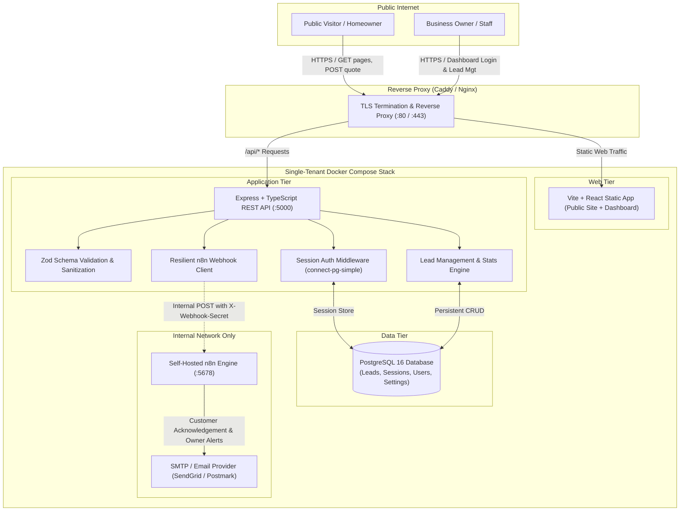
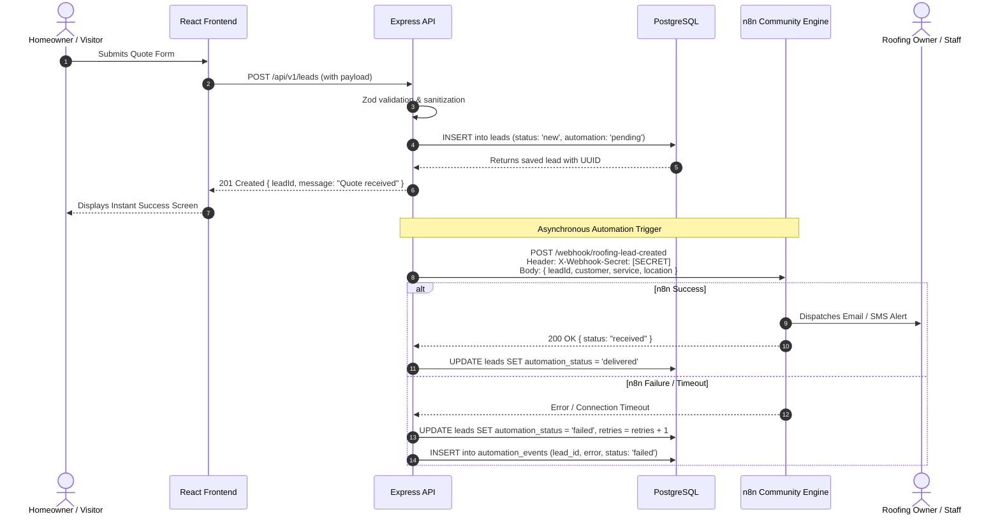

# System Architecture Specification

## 1. Executive Summary & Purpose

The **Roofing Lead Management & Automation System** is an extensible, single-tenant web application and lead-automation platform tailored for roofing contractors. Each deployment provides a distinct roofing company with:
1. A high-converting, responsive public marketing website with an interactive decision-tree chatbot and quote submission intake.
2. A secure, role-based internal administrative dashboard for managing leads, recording follow-up interactions, and reviewing real-time conversion metrics.
3. An asynchronous automation pipeline powered by self-hosted n8n to deliver instant notifications and scheduled customer follow-ups.

Each roofing business client operates on a **dedicated, isolated deployment** (isolated PostgreSQL database, backend instance, frontend static bundle, and n8n engine) deployed on a VPS via Docker Compose.

---

## 2. Documentation Authority & Organization

> [!IMPORTANT]
> **Project Brief Authority**: [Overview.md](file:///Users/aljonfernando/Documents/roofing-lead-management-&-automation-system/Overview.md) located at the workspace root is the **single authoritative source of business requirements** for this project. 
>
> To avoid document drift or conflicting specifications, we recommend **keeping `Overview.md` at the repository root** as the primary project brief and linking to it directly from this documentation suite. A duplicate `docs/PROJECT_OVERVIEW.md` must not be created.

Related technical specifications in this suite:
- [REQUIREMENTS.md](file:///Users/aljonfernando/Documents/roofing-lead-management-&-automation-system/docs/REQUIREMENTS.md): Functional and non-functional requirements.
- [DATABASE_SCHEMA.md](file:///Users/aljonfernando/Documents/roofing-lead-management-&-automation-system/docs/DATABASE_SCHEMA.md): PostgreSQL entities, migrations, and Drizzle models.
- [API_SPECIFICATION.md](file:///Users/aljonfernando/Documents/roofing-lead-management-&-automation-system/docs/API_SPECIFICATION.md): REST endpoints, schemas, and webhook contracts.
- [SECURITY.md](file:///Users/aljonfernando/Documents/roofing-lead-management-&-automation-system/docs/SECURITY.md): Threat modeling, session auth, rate limiting, and RBAC.
- [DEPLOYMENT.md](file:///Users/aljonfernando/Documents/roofing-lead-management-&-automation-system/docs/DEPLOYMENT.md): Containerization, n8n licensing, networking, and backup protocols.
- [IMPLEMENTATION_PLAN.md](file:///Users/aljonfernando/Documents/roofing-lead-management-&-automation-system/docs/IMPLEMENTATION_PLAN.md): Staged delivery milestones.

---

## 3. High-Level System Architecture

The application adopts a **4-tier service architecture** designed for clean separation of concerns, high resilience, and zero client data bleeding.

---

## 4. Key Architectural Principles & Component Boundaries

### 4.1. Single-Tenant Data Isolation
- To guarantee strict privacy and eliminate multi-tenant leak vectors, **every roofing client receives a separate VPS deployment or isolated container stack**.
- Client customer records, follow-up notes, and business configuration never share database schemas or tables with other companies.

### 4.2. Database as Primary Source of Truth
- The PostgreSQL database is the sole authoritative store. External tools like Google Sheets or CRM systems are optional downstream consumers, never system-of-record dependencies.
- **Fail-Safe Lead Ingestion**: When a public quote is submitted, the backend validates and commits the lead record to PostgreSQL *before* attempting to trigger any automation. 
- If n8n or an external email delivery service is offline or errors, the lead is safely recorded with an `automation_status = 'pending'` or `'failed'` flag for subsequent retry. Under no circumstances does an automation failure drop or discard customer data.

### 4.3. Hybrid Business Configuration
To balance fast white-label customization with runtime operational control, configuration follows a two-tier hybrid model:
1. **Static Branding Layer (Build/Env Time)**: Logo assets, default theme color palette, typography tokens, and default legal terms live in frontend static configuration (`src/config/branding.ts`).
2. **Operational Settings Layer (Database Stored)**: Company phone number, notification dispatch email, operational business hours, active service zip codes, and chatbot prompt decisions are stored in the PostgreSQL `business_settings` table and editable in the private dashboard by authorized Owner/Admin users.

### 4.4. Separation of Public Website and Authenticated Dashboard
- **Public Surface**: Static roofing marketing pages (Home, Services, About, Service Areas, Contact/Quote, Privacy) and decision-tree chatbot. These invoke only public, rate-limited intake endpoints.
- **Private Surface**: Dashboard pages (Login, Overview Stats, Leads List, Lead Details, Business Settings). Enforced at the network and server level by Express session authentication cookies (`HttpOnly`, `SameSite=Lax`, `Secure`). Client-side route hiding is treated purely as a UI convenience; all API endpoints enforce server-side session checks.

---

## 5. Automation Architecture (Backend-to-n8n Integration)

The backend interacts with n8n via authenticated webhooks over an **internal Docker bridge network** (`backend_net`):

### 5.1. n8n Deployment & Security Isolation
- The n8n Webhook node listens only on the internal Docker network or behind an authenticated internal proxy route.
- The n8n web editor UI is **never exposed directly to the public internet**. Access for workflow adjustments is restricted to `127.0.0.1` via SSH tunneling or basic-auth protected internal endpoints.

---

## 6. Assumptions & Unresolved Questions

### 6.1. Architectural Assumptions
1. **Deployment Footprint**: Each client's production deployment runs on a modest VPS (2 vCPU, 4GB RAM minimum to comfortably host PostgreSQL, Node.js, and n8n).
2. **Email Provider**: The client will supply SMTP credentials or API keys (e.g., SendGrid, Postmark, AWS SES, or Brevo) configured inside n8n credential stores for sending customer and staff emails.
3. **Internal Chatbot Logic**: The MVP chatbot operates as a rule-based decision tree embedded in the frontend, requiring zero external LLM API costs or token latencies.

### 6.2. Decisions Resolved in Milestone 1
- **Backend**: Express + TypeScript.
- **ORM**: Drizzle ORM with version-controlled migrations.
- **Sessions**: Express-session with PostgreSQL session store (`connect-pg-simple`).
- **Validation**: Zod across API and environment variables.
- **Repository**: Single monorepo containing `frontend/`, `backend/`, and shared types.
- **User Management**: Individual accounts with Owner/Admin and Staff roles; no self-registration.

### 6.3. Unresolved Questions for User Review
1. **SMS Notifications**: Should n8n lead alerts to the business owner include SMS (e.g., Twilio) in the MVP, or is email notification sufficient for initial release?
2. **Static Asset Storage**: Are company logo uploads and lead photo attachments stored locally on Docker persistent volumes, or will an S3-compatible object store (e.g., Cloudflare R2, AWS S3) be configured? (Default assumption for MVP: local persistent volume).
