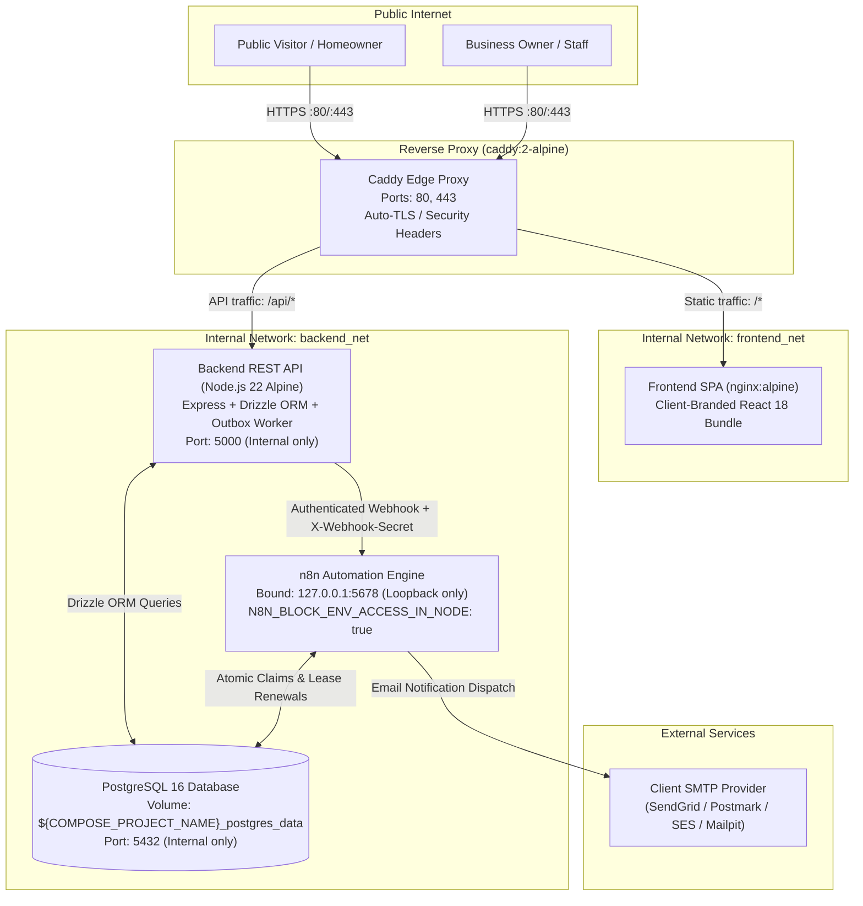
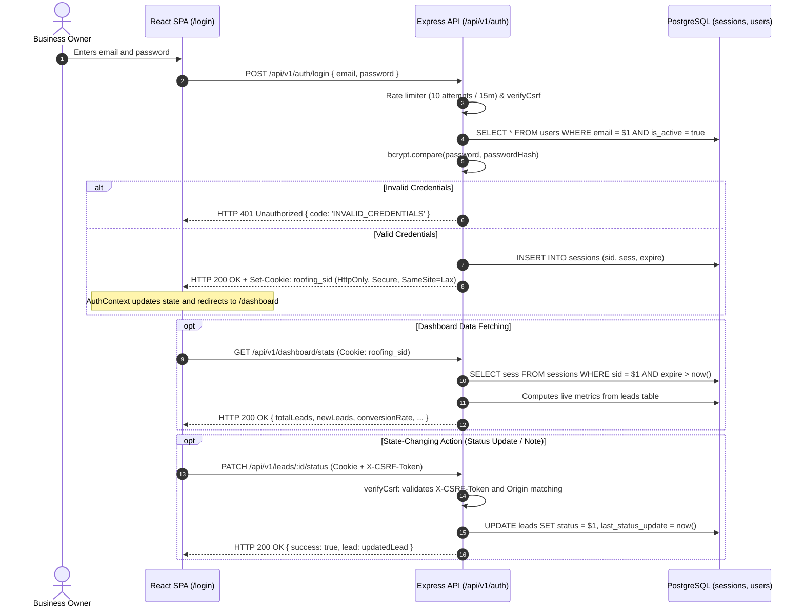
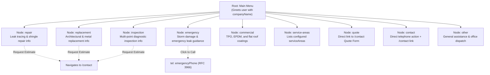

# System Architecture Specification — Roofing Lead Management System

## 1. Executive Summary & Purpose

The **Roofing Lead Management & Automation System** is an extensible, single-tenant web application and lead-automation platform tailored specifically for roofing contractors. Each deployment provides a distinct roofing company with:
1. A high-converting, responsive public marketing website with an interactive decision-tree chatbot and quote intake.
2. A secure, role-based internal administrative dashboard for managing leads, recording follow-up interactions, and reviewing real-time conversion metrics.
3. An asynchronous automation pipeline powered by self-hosted n8n to deliver instant staff dispatch notifications and customer acknowledgements.

Each roofing business client operates on a **dedicated, isolated deployment** (isolated PostgreSQL database, backend instance, frontend static bundle, and n8n engine) deployed on a VPS via Docker Compose.

---

## 2. Documentation Authority & Organization

> [!IMPORTANT]
> **Project Brief Authority**: [`Overview.md`](file:///Users/aljonfernando/Documents/roofing-lead-management-&-automation-system/Overview.md) located at the workspace root is the **single authoritative source of business requirements** for this project. 
>
> Related technical specifications in this documentation suite:
> - [`docs/PAGE_AND_SCREEN_REFERENCE.md`](file:///Users/aljonfernando/Documents/roofing-lead-management-&-automation-system/docs/PAGE_AND_SCREEN_REFERENCE.md): Screen-by-screen inventory of all public pages, dashboard views, actions, and states.
> - [`docs/CONFIGURATION_REFERENCE.md`](file:///Users/aljonfernando/Documents/roofing-lead-management-&-automation-system/docs/CONFIGURATION_REFERENCE.md): Complete reference of all environment variables, build arguments, and runtime flags.
> - [`docs/API_SPECIFICATION.md`](file:///Users/aljonfernando/Documents/roofing-lead-management-&-automation-system/docs/API_SPECIFICATION.md): REST endpoints, schemas, error codes, and webhook contracts.
> - [`docs/DATABASE_SCHEMA.md`](file:///Users/aljonfernando/Documents/roofing-lead-management-&-automation-system/docs/DATABASE_SCHEMA.md): PostgreSQL entities, migrations 0000–0003, and Drizzle models.
> - [`docs/SECURITY.md`](file:///Users/aljonfernando/Documents/roofing-lead-management-&-automation-system/docs/SECURITY.md): Threat modeling, session auth, rate limiting, and n8n boundary enforcement.
> - [`docs/DEPLOYMENT.md`](file:///Users/aljonfernando/Documents/roofing-lead-management-&-automation-system/docs/DEPLOYMENT.md): Containerization, headless credential provisioning, networking, and backup protocols.
> - [`docs/REQUIREMENTS.md`](file:///Users/aljonfernando/Documents/roofing-lead-management-&-automation-system/docs/REQUIREMENTS.md): Functional and non-functional requirements.

---

## 3. High-Level System Architecture & Container Topology

The deployment architecture is organized into **5 containerized services** connected across two isolated Docker bridge networks:



### 3.1. Container Services Breakdown

| Service Name | Image / Dockerfile | Purpose | Network | Published Ports | Volume Mounts |
| :--- | :--- | :--- | :--- | :--- | :--- |
| `proxy` | `caddy:2-alpine` | Edge reverse proxy, TLS termination, HTTP->HTTPS redirect, security headers. | `frontend_net` | `80:80`, `443:443` | `caddy_data`, `caddy_config`, `./caddy/Caddyfile:ro` |
| `frontend` | `frontend/Dockerfile` | Static SPA web server (Nginx Alpine) serving compiled React 18 / Vite bundle. | `frontend_net` | None (Internal) | None |
| `backend` | `backend/Dockerfile` | Express REST API and background transactional outbox delivery worker. | `frontend_net`, `backend_net` | None (Internal) | None |
| `db` | `postgres:16-alpine` | Relational database storing leads, sessions, outbox events, and n8n claim records. | `backend_net` | None (Internal) | `${COMPOSE_PROJECT_NAME}_postgres_data` |
| `n8n` | `n8nio/n8n:latest` | Workflow automation engine executing notification delivery and concurrency fencing. | `backend_net` | `127.0.0.1:${N8N_HOST_PORT:-5678}:5678` | `${COMPOSE_PROJECT_NAME}_n8n_data` |

### 3.2. Network Boundaries & Port Isolation
1. **Edge Isolation (`frontend_net`)**: The Caddy proxy routes external requests to either the static Nginx frontend (`/*`) or the backend Express API (`/api/*`). Neither the database nor the n8n container is connected to `frontend_net`.
2. **Data Tier Isolation (`backend_net`)**: The PostgreSQL database (port `5432`) is **completely unmapped** to the host machine. Only the backend API and the n8n container can communicate with the database over the private bridge network.
3. **n8n Host Binding**: Port `5678` is bound **strictly to `127.0.0.1`** (loopback interface). Caddy does not route public traffic to n8n. Webhook calls are dispatched internally over `backend_net` from the backend API. Administrative access requires an SSH encrypted tunnel to the VPS host.

---

## 4. End-to-End Request Flows & Subsystems

### 4.1. Browser to Frontend to Backend Request Flow

1. **Static SPA Delivery**: The browser issues a `GET /` request. Caddy proxies to the Nginx frontend container, which delivers the cached React SPA bundle (`index.html`, CSS, and JS chunks).
2. **Client-Side Routing**: React Router manages client-side navigation (`/services`, `/about`, `/service-areas`, `/contact`, `/login`, `/dashboard`). No server round-trip is required for navigation.
3. **API Proxying**: Client API calls target `/api/v1/*`. Caddy strips edge TLS and forwards the requests directly to the Node.js Express backend on port `5000`.
4. **CORS & Origin Verification**: Express verifies `Origin` headers against `CLIENT_ORIGIN` and enforces helmet security headers (CSP, HSTS, X-Content-Type-Options, X-Frame-Options: DENY).

---

### 4.2. Quote Intake & Transactional Outbox Flow

The system implements the **Transactional Outbox Pattern** to ensure zero data loss during network disruptions or automation failures:

```mermaid
sequenceDiagram
    autonumber
    actor Homeowner as Homeowner / Visitor
    participant Browser as React SPA (QuoteForm)
    participant API as Express API (/api/v1/leads)
    participant DB as PostgreSQL Database
    participant Worker as Background Outbox Worker
    participant N8N as n8n Automation Engine
    participant SMTP as Client SMTP Provider

    Homeowner->>Browser: Fills quote form and clicks "Request Free Estimate"
    Browser->>Browser: Client-side validation & honeypot (_hp) check
    Browser->>API: POST /api/v1/leads (CreateLeadDto JSON)
    API->>API: Rate limiter check (5 per 10m) & Zod server-side validation
    API->>DB: Check business availability & quote intake policy (checkQuoteIntakeAllowed)

    alt Quote Intake Paused
        API-->>Browser: HTTP 422 Unprocessable Entity { error: { code: 'QUOTE_INTAKE_PAUSED' } }
        Browser-->>Homeowner: Displays intake paused card with phone & emergency call links
    else Intake Allowed
        rect rgb(240, 248, 255)
            Note over API,DB: Single ACID Database Transaction
            API->>DB: INSERT INTO leads (status='new', automation_status='pending')
            API->>DB: INSERT INTO outbox_events (aggregate_id=lead.id, payload=eventPayload, idempotency_key=UUID, status='pending')
            DB-->>API: Transaction Committed (Lead ID generated)
        end

        API-->>Browser: HTTP 201 Created { success: true, data: { leadId, referenceId } }
        Browser-->>Homeowner: Displays confirmation panel with turnaround estimate
    end

    rect rgb(255, 250, 240)
        Note over Worker,N8N: Asynchronous Outbox Delivery Loop (Every 5s)
        Worker->>DB: SELECT outbox_events FOR UPDATE SKIP LOCKED WHERE status IN ('pending', 'processing') AND next_retry_at <= now()
        Worker->>DB: UPDATE outbox_events SET status='processing', next_retry_at=now() + 5m
        Worker->>N8N: POST /webhook/roofing-lead-created<br/>Headers: X-Webhook-Secret, X-Idempotency-Key<br/>Body: eventPayload (JSON)

        alt Secret Missing or Incorrect
            N8N-->>Worker: HTTP 403 Forbidden (Halted at boundary; 0 executions)
            Worker->>DB: Marks retry with exponential backoff
        else Valid Authentication & Idempotency Key
            N8N->>DB: SELECT * FROM acquire_n8n_lead_claim(idempotencyKey, leadId)
            alt Already Completed
                DB-->>N8N: claim_status = 'ALREADY_COMPLETED'
                N8N-->>Worker: HTTP 200 OK (already_processed; 0 emails sent)
            else Concurrent Lease Active
                DB-->>N8N: claim_status = 'CONCURRENT_LOCKED'
                N8N-->>Worker: HTTP 409 Conflict (Worker backs off and retries)
            else Claim Acquired
                DB-->>N8N: claim_status = 'CLAIM_ACQUIRED', claim_version = N
                N8N->>SMTP: Dispatch staff notification email
                N8N->>DB: UPDATE n8n_processed_events SET staff_notified=true
                opt Customer email provided
                    N8N->>SMTP: Dispatch customer acknowledgement email
                    N8N->>DB: UPDATE n8n_processed_events SET customer_notified=true
                end
                N8N->>DB: UPDATE n8n_processed_events SET status='completed', processed_at=now()
                N8N-->>Worker: HTTP 200 OK { success: true, status: 'received', confirmed: true }
                Worker->>DB: UPDATE outbox_events SET status='delivered', delivered_at=now()
                Worker->>DB: UPDATE leads SET automation_status='delivered'
            end
        end
    end
```

---

### 4.3. Concurrency Fencing, Leases & Database Claims

1. **The PostgreSQL Snapshot Race Problem**: Under PostgreSQL's default `READ COMMITTED` transaction isolation, concurrent multi-clause CTE queries (`try_insert` + `fallback_read`) suffer from snapshot invisibility. If transaction $T_1$ commits between the insert and read of transaction $T_2$, $T_2$ cannot see $T_1$'s committed row, potentially causing duplicate notification dispatches.
2. **Resolution via Stored Function (`acquire_n8n_lead_claim`)**: Defined in migration [`0003_n8n_claim_functions.sql`](file:///Users/aljonfernando/Documents/roofing-lead-management-&-automation-system/backend/drizzle/0003_n8n_claim_functions.sql):
   - Tries `INSERT INTO n8n_processed_events ... ON CONFLICT (idempotency_key) DO NOTHING`.
   - If row exists, locks it explicitly using `SELECT ... FOR UPDATE`. Under `READ COMMITTED`, `FOR UPDATE` re-evaluates the latest committed version of the row, eliminating the snapshot race.
   - If `status == 'completed'`, returns `claim_status = 'ALREADY_COMPLETED'`.
   - If `lease_expires_at <= now()`, atomically reclaims the lease, increments `claim_version`, extends the lease by 5 minutes, and returns `claim_status = 'CLAIM_ACQUIRED'`.
   - If lease is active (`lease_expires_at > now()`), returns `claim_status = 'CONCURRENT_LOCKED'` (mapped to HTTP 409 in n8n).
3. **Pre-Flight Lease Verification (`verify_and_renew_n8n_claim`)**:
   - Before executing external SMTP network calls, n8n verifies that its `claim_version` is still valid and has not been reclaimed by another worker due to a slow execution.
   - If the lease expired or the fencing token changed, n8n immediately aborts without dispatching duplicate emails.
4. **Partial-Failure Recovery**:
   - `staff_notified` and `customer_notified` booleans are tracked independently in `n8n_processed_events`.
   - If staff dispatch succeeds but customer dispatch fails, the next retry skips the staff alert and attempts only the customer acknowledgement.

---

### 4.4. n8n Security Boundaries & Credential Isolation

1. **Native Header Auth at Webhook Boundary**:
   - The Webhook node enforces authentication using built-in `headerAuth` referencing credential `HEADER_AUTH_CREDENTIAL_ID` ("Roofing Webhook Auth").
   - Incoming requests must supply `X-Webhook-Secret` matching `N8N_WEBHOOK_SECRET`.
   - **Zero Downstream Execution**: Unauthorized requests return `HTTP 403 Forbidden` and record **zero** execution entities in n8n's SQLite database, ensuring no Code nodes, database queries, or subflows run.
   - **Upstream Header Artifact**: The `WWW-Authenticate: Basic realm="Webhook"` header observed on 403 errors is hardcoded in upstream n8n's `Webhook.node.js:228` for all authorization errors, even under Header Auth. Runtime evaluation is strictly `headerAuth`.
2. **Restricted Node Sandbox**:
   - `N8N_BLOCK_ENV_ACCESS_IN_NODE: "true"` is actively enforced in `docker-compose.yml`.
   - Workflow Code nodes are blocked from reading container environment variables, safeguarding `N8N_ENCRYPTION_KEY`, basic auth passwords, and internal container secrets.
   - Workflow Code nodes contain **zero `$env` references**.
3. **Server-Controlled Notification Metadata**:
   - `companyName`, `dispatchEmail`, and `staffNotificationEmail` are injected into the outbox event payload by the backend API from validated server environment variables.
   - Anonymous quote submitters cannot override or spoof recipient notification email addresses.

---

### 4.5. Authentication, Sessions & CSRF Protection



1. **Server-Managed Sessions**: Authenticated sessions are stored in the PostgreSQL `sessions` table using `connect-pg-simple`. Session cookies (`roofing_sid`) are `HttpOnly`, `SameSite=Lax`, and `Secure` (enforced in production).
2. **CSRF Mitigation**: State-changing endpoints (`POST`, `PATCH`, `PUT`, `DELETE`) pass through `verifyCsrf` middleware, which validates session-bound tokens (`X-CSRF-Token`) and strictly matches request `Origin` headers against `CLIENT_ORIGIN`.
3. **Role-Based Access Control**:
   - Dashboard endpoints require valid session (`requireAuth`).
   - Lead management, notes, status changes, and dashboard statistics require `requireRole(["owner", "admin"])`.
   - Public quote submission (`POST /api/v1/leads`) and public business info (`GET /api/v1/business/public-info`) require no authentication.

---

### 4.6. Chatbot Decision-Tree Subsystem

The public chatbot is an **interactive client-side decision tree**, not an artificial intelligence / LLM agent:



- **Implementation**: [`src/components/chat/ChatbotWidget.tsx`](file:///Users/aljonfernando/Documents/roofing-lead-management-&-automation-system/frontend/src/components/chat/ChatbotWidget.tsx) and [`src/config/chatbotTree.ts`](file:///Users/aljonfernando/Documents/roofing-lead-management-&-automation-system/frontend/src/config/chatbotTree.ts).
- **Zero External AI Dependencies**: Runs 100% in the client browser with zero latency, zero token costs, and zero risk of hallucinating pricing, warranty guarantees, or unverified claims.
- **Vanity Phone Normalization**: Automatically converts keypad vanity letters (e.g. `(555) 999-HELP` -> `(555) 999-4357`) into standard dialable RFC 3966 `tel:` links.
---

### 4.7. Dynamic Business Availability & Lazy Scheduled Reopening

The system provides dynamic business availability controls without requiring a frontend rebuild or container restart:

1. **Persisted Source of Truth**: Availability settings reside in PostgreSQL `business_settings` and are administered through `/dashboard/settings` by authorized `owner` and `admin` roles.
2. **Three Operational States**:
   - `available`: Standard operations; no closure banner.
   - `temporarily_unavailable`: Displays public notice headline and body with optional scheduled reopening time.
   - `unavailable_indefinite`: Displays public notice without inventing a reopening time.
3. **Independent Quote Intake Policy**:
   - Controlled by `accept_quotes_when_unavailable`.
   - When active during closures, public quote requests remain usable with a delayed follow-up notice banner.
   - When paused, the public quote form is replaced by an advisory notice with direct calling links. In addition, the backend enforces the policy on `POST /api/v1/leads`, rejecting attempts with `422 QUOTE_INTAKE_PAUSED` without creating lead or outbox records.
4. **Concurrency-Safe Lazy Reopening**:
   - When `auto_resume = true` and `reopen_at <= now()`, requests to `getPublicBusinessInfo()` or `checkQuoteIntakeAllowed()` execute an atomic database transition restoring `available` status.
   - Operates without requiring an external OS cron daemon or dedicated background service.

---

## 5. Database Schema & Data Ownership

PostgreSQL 16 is the **sole system of record**. All schema definitions are managed in [`backend/src/db/schema.ts`](file:///Users/aljonfernando/Documents/roofing-lead-management-&-automation-system/backend/src/db/schema.ts) with version-controlled SQL migrations:

| Table Name | Migration | Primary Key | Description & Data Ownership |
| :--- | :--- | :--- | :--- |
| `users` | `0000` | `id` (UUID) | Authenticated user accounts (`owner`, `admin`, `staff`). Passwords hashed with bcrypt (cost factor 12). |
| `sessions` | `0000` | `sid` (varchar) | Persistent HTTP session store managed by `connect-pg-simple`. |
| `business_settings` | `0000`–`0004` | `id` (UUID) | Client operational identity, phone numbers, license, service areas, business hours, and dynamic availability controls. |
| `leads` | `0000` | `id` (UUID) | Inbound customer quote inquiries, contact data, service requests, lead status, and automation delivery status. |
| `lead_notes` | `0000` | `id` (UUID) | User-attributed follow-up notes linked to `leads.id` with author foreign key referencing `users.id`. |
| `outbox_events` | `0000` | `id` (UUID) | Transactional outbox queue for reliable asynchronous dispatch to n8n. |
| `n8n_processed_events`| `0001`–`0003` | `idempotency_key` (UUID) | Workflow deduplication store, atomic row claims, 5-minute lease fencing, and notification booleans (`staff_notified`, `customer_notified`). |

---

## 6. Implementation Scope vs. Future Roadmap

| Subsystem / Capability | Current Implemented Status | Future Roadmap / Deferred |
| :--- | :--- | :--- |
| **Public Website** | Fully implemented (Home, Services, About, Service Areas, Contact, Privacy, Dynamic Notice Banner). | Photo upload / roof damage image attachments. |
| **Chatbot Widget** | Deterministic decision tree with vanity phone normalization. | LLM / conversational AI agent integration. |
| **Lead Management** | Fully implemented (Search, Filter, Pagination, Lead Details, Notes, Status updates). | Export to CSV / PDF lead reports. |
| **Business Settings** | Fully implemented in-app GUI dashboard settings (`/dashboard/settings`), dynamic public notice banner, quote intake enforcement, and lazy scheduled reopening. | Granular holiday schedule overrides and shift calendar model (Milestone 13). |
| **User Management** | Seeded via CLI (`npm run db:seed`); SQL administration. | In-app team member invitation and RBAC management UI (Milestone 12). |
| **Notifications** | Automated email alerts via n8n (staff alert + customer receipt). | SMS / WhatsApp notifications (Twilio). |
| **Tenant Model** | Single-tenant per deployment (isolated VPS / Docker stack). | Multi-tenant SaaS dashboard. |
