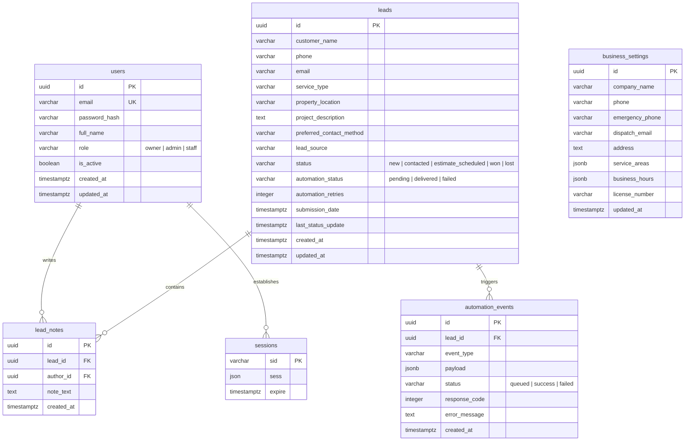

# Database Schema Specification

## 1. Overview & Technology Standards

The data tier is powered by **PostgreSQL 16**, managed through **Drizzle ORM** with version-controlled SQL migrations (`drizzle-kit`). All foreign keys enforce referential integrity, timestamps include timezone information (`TIMESTAMPTZ`), and UUIDs are generated via `gen_random_uuid()`.

### 1.1. Core Design Decisions
- **Single-Tenant Database**: Each deployment connects to a dedicated PostgreSQL database instance or database name (`roofing_leads`).
- **Server Sessions**: Persistent HTTP sessions are stored in the `sessions` table using the standard `connect-pg-simple` schema.
- **Auditability**: Lead status changes and follow-up notes are strictly timestamped with user attribution.
- **Automation Telemetry**: The `automation_events` table preserves a detailed log of all backend-to-n8n webhook triggers and outcomes.

---

## 2. Entity-Relationship Diagram



---

## 3. Detailed Table Specifications

### 3.1. `users` Table
Stores authenticated business owners and staff members.

| Column | Data Type | Nullable | Default | Description |
| :--- | :--- | :--- | :--- | :--- |
| `id` | `UUID` | No | `gen_random_uuid()` | Primary Key |
| `email` | `VARCHAR(255)` | No | - | Unique login email (normalized to lowercase) |
| `password_hash` | `VARCHAR(255)` | No | - | Argon2id or bcrypt hash |
| `full_name` | `VARCHAR(150)` | No | - | Display name of staff member |
| `role` | `VARCHAR(20)` | No | `'staff'` | Role: `'owner'`, `'admin'`, or `'staff'` |
| `is_active` | `BOOLEAN` | No | `true` | Account active flag |
| `created_at` | `TIMESTAMPTZ` | No | `now()` | Record creation timestamp |
| `updated_at` | `TIMESTAMPTZ` | No | `now()` | Record last update timestamp |

**Indexes & Constraints**:
- `users_pkey`: `PRIMARY KEY (id)`
- `users_email_unique`: `UNIQUE (email)`
- `idx_users_role`: `INDEX (role)`

---

### 3.2. `sessions` Table
Standard session table required by `connect-pg-simple` for Express server-side session management.

| Column | Data Type | Nullable | Default | Description |
| :--- | :--- | :--- | :--- | :--- |
| `sid` | `VARCHAR(255)` | No | - | Session ID (Primary Key) |
| `sess` | `JSON` | No | - | Serialized session object (stores `userId`, `role`) |
| `expire` | `TIMESTAMPTZ` | No | - | Expiration timestamp |

**Indexes & Constraints**:
- `sessions_pkey`: `PRIMARY KEY (sid)`
- `idx_sessions_expire`: `INDEX (expire)` (enables periodic cleanup of expired sessions)

---

### 3.3. `business_settings` Table
Stores runtime operational settings for the white-labeled deployment. Contains exactly one record per deployment.

| Column | Data Type | Nullable | Default | Description |
| :--- | :--- | :--- | :--- | :--- |
| `id` | `UUID` | No | `gen_random_uuid()` | Primary Key |
| `company_name` | `VARCHAR(200)` | No | `'Roofing Company'` | Commercial DBA name |
| `phone` | `VARCHAR(50)` | No | `''` | Primary customer contact phone |
| `emergency_phone`| `VARCHAR(50)` | Yes | `NULL` | 24/7 storm damage emergency number |
| `dispatch_email` | `VARCHAR(255)` | No | `''` | Lead notification alert email |
| `address` | `TEXT` | Yes | `NULL` | Physical business office address |
| `service_areas` | `JSONB` | No | `'[]'::jsonb` | Array of covered cities/counties/zip codes |
| `business_hours` | `JSONB` | No | `'{}'::jsonb` | Operating schedule object |
| `license_number` | `VARCHAR(100)` | Yes | `NULL` | State contractor license ID |
| `created_at` | `TIMESTAMPTZ` | No | `now()` | Initial config creation timestamp |
| `updated_at` | `TIMESTAMPTZ` | No | `now()` | Last modification timestamp |

---

### 3.4. `leads` Table
Primary entity storing incoming quote requests and customer inquiries.

| Column | Data Type | Nullable | Default | Description |
| :--- | :--- | :--- | :--- | :--- |
| `id` | `UUID` | No | `gen_random_uuid()` | Primary Key |
| `customer_name` | `VARCHAR(150)` | No | - | Full name of the homeowner |
| `phone` | `VARCHAR(50)` | No | - | Contact phone number |
| `email` | `VARCHAR(255)` | Yes | `NULL` | Contact email address |
| `service_type` | `VARCHAR(100)` | No | - | Category: Replacement, Repair, Inspection, etc. |
| `property_location`| `VARCHAR(255)`| No | - | Street address, city, or zip code |
| `project_description`| `TEXT` | Yes | `NULL` | Customer notes or problem description |
| `preferred_contact_method`| `VARCHAR(20)` | No | `'phone'` | `'phone'`, `'sms'`, or `'email'` |
| `lead_source` | `VARCHAR(50)` | No | `'website_form'` | Source: `'website_form'`, `'chatbot'`, etc. |
| `status` | `VARCHAR(30)` | No | `'new'` | `'new'`, `'contacted'`, `'estimate_scheduled'`, `'won'`, `'lost'` |
| `automation_status`| `VARCHAR(20)` | No | `'pending'` | `'pending'`, `'delivered'`, `'failed'` |
| `automation_retries`| `INTEGER` | No | `0` | Number of webhook attempts to n8n |
| `submission_date`| `TIMESTAMPTZ` | No | `now()` | Customer form submission timestamp |
| `last_status_update`| `TIMESTAMPTZ`| No | `now()` | Timestamp of last status change |
| `created_at` | `TIMESTAMPTZ` | No | `now()` | Record creation timestamp |
| `updated_at` | `TIMESTAMPTZ` | No | `now()` | Record update timestamp |

**Indexes & Constraints**:
- `leads_pkey`: `PRIMARY KEY (id)`
- `idx_leads_status`: `INDEX (status)` (for dashboard status filtering)
- `idx_leads_submission_date`: `INDEX (submission_date DESC)` (for recent leads list)
- `idx_leads_automation_status`: `INDEX (automation_status)` (for background retry workers)
- `idx_leads_search`: `INDEX (customer_name, phone, email)` (for staff lead search)

---

### 3.5. `lead_notes` Table
Follow-up log entries added by staff members to record phone calls, inspections, and customer conversations.

| Column | Data Type | Nullable | Default | Description |
| :--- | :--- | :--- | :--- | :--- |
| `id` | `UUID` | No | `gen_random_uuid()` | Primary Key |
| `lead_id` | `UUID` | No | - | Foreign Key -> `leads(id)` ON DELETE CASCADE |
| `author_id` | `UUID` | Yes | `NULL` | Foreign Key -> `users(id)` ON DELETE SET NULL |
| `note_text` | `TEXT` | No | - | Content of follow-up note |
| `created_at` | `TIMESTAMPTZ` | No | `now()` | Creation timestamp |

**Indexes & Constraints**:
- `lead_notes_pkey`: `PRIMARY KEY (id)`
- `idx_lead_notes_lead_id`: `INDEX (lead_id, created_at DESC)`

---

### 3.6. `automation_events` Table
Audit trail of outbound webhook calls from the backend to n8n.

| Column | Data Type | Nullable | Default | Description |
| :--- | :--- | :--- | :--- | :--- |
| `id` | `UUID` | No | `gen_random_uuid()` | Primary Key |
| `lead_id` | `UUID` | No | - | Foreign Key -> `leads(id)` ON DELETE CASCADE |
| `event_type` | `VARCHAR(50)` | No | `'lead_created'` | Event type name |
| `payload` | `JSONB` | No | - | Exact JSON payload sent to webhook |
| `status` | `VARCHAR(20)` | No | `'queued'` | `'queued'`, `'success'`, or `'failed'` |
| `response_code` | `INTEGER` | Yes | `NULL` | HTTP response code from n8n |
| `error_message` | `TEXT` | Yes | `NULL` | Error details if webhook failed |
| `created_at` | `TIMESTAMPTZ` | No | `now()` | Event dispatch timestamp |

---

## 4. Drizzle ORM Schema Blueprint (TypeScript)

```typescript
import { pgTable, uuid, varchar, text, boolean, timestamp, integer, json, jsonb, index } from "drizzle-orm/pg-core";
import { relations } from "drizzle-orm";

// 1. Users
export const users = pgTable("users", {
  id: uuid("id").primaryKey().defaultRandom(),
  email: varchar("email", { length: 255 }).notNull().unique(),
  passwordHash: varchar("password_hash", { length: 255 }).notNull(),
  fullName: varchar("full_name", { length: 150 }).notNull(),
  role: varchar("role", { length: 20 }).notNull().default("staff"), // 'owner' | 'admin' | 'staff'
  isActive: boolean("is_active").notNull().default(true),
  createdAt: timestamp("created_at", { withTimezone: true }).notNull().defaultNow(),
  updatedAt: timestamp("updated_at", { withTimezone: true }).notNull().defaultNow(),
}, (table) => ({
  roleIdx: index("idx_users_role").on(table.role),
}));

// 2. Sessions (connect-pg-simple)
export const sessions = pgTable("sessions", {
  sid: varchar("sid", { length: 255 }).primaryKey(),
  sess: json("sess").notNull(),
  expire: timestamp("expire", { withTimezone: true }).notNull(),
}, (table) => ({
  expireIdx: index("idx_sessions_expire").on(table.expire),
}));

// 3. Business Settings
export const businessSettings = pgTable("business_settings", {
  id: uuid("id").primaryKey().defaultRandom(),
  companyName: varchar("company_name", { length: 200 }).notNull().default("Roofing Company"),
  phone: varchar("phone", { length: 50 }).notNull().default(""),
  emergencyPhone: varchar("emergency_phone", { length: 50 }),
  dispatchEmail: varchar("dispatch_email", { length: 255 }).notNull().default(""),
  address: text("address"),
  serviceAreas: jsonb("service_areas").notNull().default([]),
  businessHours: jsonb("business_hours").notNull().default({}),
  licenseNumber: varchar("license_number", { length: 100 }),
  createdAt: timestamp("created_at", { withTimezone: true }).notNull().defaultNow(),
  updatedAt: timestamp("updated_at", { withTimezone: true }).notNull().defaultNow(),
});

// 4. Leads
export const leads = pgTable("leads", {
  id: uuid("id").primaryKey().defaultRandom(),
  customerName: varchar("customer_name", { length: 150 }).notNull(),
  phone: varchar("phone", { length: 50 }).notNull(),
  email: varchar("email", { length: 255 }),
  serviceType: varchar("service_type", { length: 100 }).notNull(),
  propertyLocation: varchar("property_location", { length: 255 }).notNull(),
  projectDescription: text("project_description"),
  preferredContactMethod: varchar("preferred_contact_method", { length: 20 }).notNull().default("phone"),
  leadSource: varchar("lead_source", { length: 50 }).notNull().default("website_form"),
  status: varchar("status", { length: 30 }).notNull().default("new"), // 'new' | 'contacted' | 'estimate_scheduled' | 'won' | 'lost'
  automationStatus: varchar("automation_status", { length: 20 }).notNull().default("pending"),
  automationRetries: integer("automation_retries").notNull().default(0),
  submissionDate: timestamp("submission_date", { withTimezone: true }).notNull().defaultNow(),
  lastStatusUpdate: timestamp("last_status_update", { withTimezone: true }).notNull().defaultNow(),
  createdAt: timestamp("created_at", { withTimezone: true }).notNull().defaultNow(),
  updatedAt: timestamp("updated_at", { withTimezone: true }).notNull().defaultNow(),
}, (table) => ({
  statusIdx: index("idx_leads_status").on(table.status),
  submissionDateIdx: index("idx_leads_submission_date").on(table.submissionDate),
  automationStatusIdx: index("idx_leads_automation_status").on(table.automationStatus),
}));

// 5. Lead Notes
export const leadNotes = pgTable("lead_notes", {
  id: uuid("id").primaryKey().defaultRandom(),
  leadId: uuid("lead_id").notNull().references(() => leads.id, { onDelete: "cascade" }),
  authorId: uuid("author_id").references(() => users.id, { onDelete: "set null" }),
  noteText: text("note_text").notNull(),
  createdAt: timestamp("created_at", { withTimezone: true }).notNull().defaultNow(),
}, (table) => ({
  leadIdIdx: index("idx_lead_notes_lead_id").on(table.leadId, table.createdAt),
}));

// 6. Automation Events
export const automationEvents = pgTable("automation_events", {
  id: uuid("id").primaryKey().defaultRandom(),
  leadId: uuid("lead_id").notNull().references(() => leads.id, { onDelete: "cascade" }),
  eventType: varchar("event_type", { length: 50 }).notNull().default("lead_created"),
  payload: jsonb("payload").notNull(),
  status: varchar("status", { length: 20 }).notNull().default("queued"),
  responseCode: integer("response_code"),
  errorMessage: text("error_message"),
  createdAt: timestamp("created_at", { withTimezone: true }).notNull().defaultNow(),
});

// Relationships
export const leadsRelations = relations(leads, ({ many }) => ({
  notes: many(leadNotes),
  events: many(automationEvents),
}));

export const leadNotesRelations = relations(leadNotes, ({ one }) => ({
  lead: one(leads, { fields: [leadNotes.leadId], references: [leads.id] }),
  author: one(users, { fields: [leadNotes.authorId], references: [users.id] }),
}));
```
