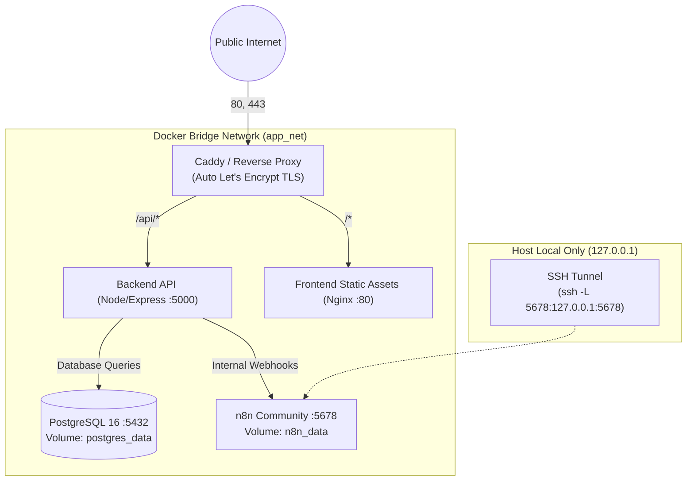

# Deployment & Infrastructure Specification

## 1. Overview & Host Environment

The system is architected for single-tenant VPS hosting using **Docker Compose**. This ensures reproducible, isolated deployments that are straightforward to back up, monitor, and maintain.

### 1.1. Minimum VPS Sizing Recommendations
- **CPU**: 2 vCPU cores
- **Memory**: 4 GB RAM (n8n requires ~1GB, PostgreSQL ~512MB–1GB, Node.js ~256MB)
- **Disk**: 40 GB NVMe / SSD storage
- **Operating System**: Ubuntu 22.04 LTS or Debian 12
- **Network**: Static public IPv4 address, DNS A-record pointing to client domain (e.g., `roofingcompany.com`)

---

## 2. Docker Compose Topology



### 2.1. Container Service Roles

| Service | Image / Base | Internal Port | Exposed Port | Purpose |
| :--- | :--- | :--- | :--- | :--- |
| `proxy` | `caddy:2-alpine` | 80, 443 | `80`, `443` | Reverse proxy, TLS certificates, rate limiting, gzip/brotli. |
| `frontend` | `nginx:alpine` | 80 | None (internal) | Serves production Vite React build. |
| `backend` | `node:22-alpine` | 5000 | None (internal) | Express REST API and session handling. |
| `db` | `postgres:16-alpine`| 5432 | None (internal) | Authoritative persistent storage. |
| `n8n` | `docker.n8n.io/n8nio/n8n:latest` | 5678 | `127.0.0.1:5678` | Workflow automation engine (localhost only). |

---

## 3. n8n Licensing & Commercial Setup

### 3.1. License Compliance (Sustainable Use License)
- The self-hosted version of n8n is distributed under the **Sustainable Use License** (Fair-code).
- **Commercial Validity**: Under this license, businesses may freely self-host and run n8n for their own **internal automation workflows** (such as routing incoming leads to sales staff and emailing quote acknowledgements).
- **Commercial Restriction**: You may not provide n8n as a commercial service or resell the n8n platform/UI to third parties as a managed automation product without a commercial agreement from n8n.
- **Project Alignment**: Because each roofing client receives their own private deployment solely automating their internal business operations, using self-hosted n8n in this single-tenant architecture fully complies with internal-use guidelines.

### 3.2. Secure Editor UI Access
- To satisfy security requirements, **the n8n graphical workflow editor is never routed over the public domain**.
- The editor port is bound exclusively to `127.0.0.1:5678` on the host VPS.
- When an engineer or business administrator needs to adjust workflows, they access the editor securely via an SSH tunnel:
  ```bash
  ssh -L 5678:127.0.0.1:5678 deploy@your-vps-ip
  ```
  Then browse locally to `http://localhost:5678`.

---

## 4. Reverse Proxy Configuration (Caddy)

Caddy provides automatic zero-configuration Let's Encrypt TLS termination and clean path-based routing:

```caddyfile
{$DOMAIN_NAME} {
    encode gzip zstd

    # API endpoints
    handle /api/* {
        reverse_proxy backend:5000
    }

    # Static frontend SPA
    handle {
        root * /usr/share/caddy
        try_files {path} /index.html
        file_server
    }

    # Security headers
    header {
        Strict-Transport-Security "max-age=31536000; includeSubDomains"
        X-Content-Type-Options "nosniff"
        X-Frame-Options "DENY"
        Referrer-Policy "strict-origin-when-cross-origin"
    }
}
```

---

## 5. Automated Database Backups & Disaster Recovery

### 5.1. Daily Backup Cron
A backup script runs nightly via host cron (`/usr/local/bin/backup-roofing-db.sh`):

```bash
#!/usr/bin/env bash
set -euo pipefail

BACKUP_DIR="/var/backups/roofing_leads"
TIMESTAMP=$(date +"%Y%m%d_%H%M%S")
FILENAME="${BACKUP_DIR}/roofing_leads_${TIMESTAMP}.sql.gz"

mkdir -p "${BACKUP_DIR}"

# Perform dump via docker exec
docker compose -f /opt/roofing-app/docker-compose.yml exec -T db \
  pg_dump -U roofing_user roofing_leads | gzip > "${FILENAME}"

# Retain backups for 14 days
find "${BACKUP_DIR}" -type f -name "*.sql.gz" -mtime +14 -delete

echo "Backup successful: ${FILENAME}"
```

### 5.2. Verified Restore Drill
To restore the database from a backup file:
```bash
# 1. Decompress and restore into PostgreSQL container
gunzip -c /var/backups/roofing_leads/roofing_leads_TIMESTAMP.sql.gz | \
  docker compose exec -T db psql -U roofing_user -d roofing_leads
```

---

## 6. White-Label Client Deployment Blueprint

To deploy an isolated instance for a new roofing contractor:
1. **Provision VPS**: Provision a Linux VPS with static IP and point client DNS (`clientdomain.com`).
2. **Clone Repository & Checkout Release**: Clone repository to `/opt/roofing-app`.
3. **Configure Environment**:
   - `cp .env.example .env`
   - Fill in client company name, unique database password, `SESSION_SECRET`, and notification dispatch email.
   - Run `chmod 600 .env` to protect secrets.
4. **Build & Start Containers**:
   ```bash
   docker compose up -d --build
   ```
5. **Run Database Migrations & Initial Seed**:
   ```bash
   docker compose exec backend npm run db:migrate
   docker compose exec backend npm run db:seed
   ```
6. **Activate n8n Workflows**: Connect via SSH tunnel, import the standardized workflow JSON templates from `automation/workflows/`, test trigger, and activate.
