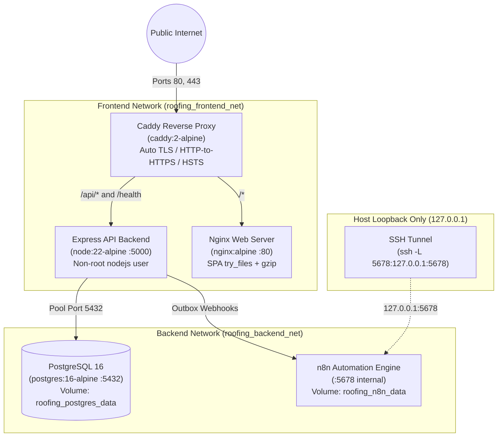

# Deployment & Infrastructure Specification — Milestone 8.1

## 1. Overview & Host Environment

The Roofing Lead Management and Automation System is architected for single-tenant VPS hosting using **Docker Compose**. This ensures reproducible, isolated deployments that are straightforward to back up, monitor, upgrade, and maintain.

### 1.1. Minimum VPS Sizing Recommendations
- **CPU**: 2 vCPU cores
- **Memory**: 4 GB RAM (n8n requires ~1GB, PostgreSQL ~512MB–1GB, Node.js backend ~256MB, Nginx/Caddy ~128MB)
- **Disk**: 40 GB NVMe / SSD storage
- **Operating System**: Ubuntu 22.04 LTS / Debian 12 / macOS (staging)
- **Runtime**: Docker Engine 24+ and Docker Compose v2 (e.g. `docker compose`)
- **Network**: Static public IPv4/IPv6 address, DNS A/AAAA-records pointing to client domain (e.g., `roofingcompany.com`)

### 1.2. Confirmed Deployment Isolation Model

**The approved production architecture is strictly ONE DEDICATED VPS PER CLIENT.**

- **Rationale**:
  - **Full Security Boundary**: Operating system, kernel memory, process table, filesystem, and network isolation between clients. No possibility of container escape or shared host resource exhaustion affecting multiple clients.
  - **Public Ingress & TLS**: Direct binding of public host ports `80` and `443` to the client's dedicated Caddy reverse proxy for automated Let's Encrypt / ZeroSSL TLS certificate issuance. This avoids complex, brittle multi-tenant reverse proxies or shared wildcard ingress routers.
  - **Automation & Loopback Isolation**: Each VPS runs a private n8n automation engine bound strictly to `127.0.0.1:5678`, accessible only by SSH tunnel to that specific client host.
  - **Resource Guarantee**: Dedicated CPU, RAM, and disk I/O guarantees consistent performance without noisy-neighbor degradation.

**Multi-Stack Staging / Local QA Environments**:
If multiple client stacks must run on a **single shared host** (for local testing, staging, or CI only):
1. Each stack must define a unique `COMPOSE_PROJECT_NAME` (e.g., `client_a`, `client_b`). This automatically isolates:
   - Named Volumes: `${COMPOSE_PROJECT_NAME}_postgres_data`, `${COMPOSE_PROJECT_NAME}_n8n_data`, etc.
   - Bridge Networks: `${COMPOSE_PROJECT_NAME}_frontend_net`, `${COMPOSE_PROJECT_NAME}_backend_net`.
   - Containers: `${COMPOSE_PROJECT_NAME}-proxy`, `${COMPOSE_PROJECT_NAME}-frontend`, etc.
2. Each stack must map **non-conflicting published host ports**:
   - Stack A: `HTTP_PORT=80`, `HTTPS_PORT=443`, `N8N_HOST_PORT=5678`
   - Stack B: `HTTP_PORT=8080`, `HTTPS_PORT=8443`, `N8N_HOST_PORT=5679`
   Without distinct published ports, Docker Compose will fail on startup with `bind: address already in use`. Do not claim multiple stacks can coexist on one host without separate published port allocations.

---

## 2. Docker Compose Topology & Networking

The system implements a zero-trust, multi-tier network topology separating frontend ingress, application logic, and persistent backend databases:



### 2.1. Container Service Roles & Isolation

| Service | Image / Base | Internal Port | Host Port Binding | Network Tier | Security / Health Probe |
| :--- | :--- | :--- | :--- | :--- | :--- |
| `proxy` | `caddy:2-alpine` | 80, 443 | `0.0.0.0:80`, `0.0.0.0:443` | `roofing_frontend_net` | Auto Let's Encrypt / ZeroSSL TLS, HSTS, HTTP/2 + HTTP/3 |
| `frontend` | Multi-stage `nginx:alpine` | 80 | None (internal) | `roofing_frontend_net` | `wget -q --spider http://127.0.0.1:80/healthz` |
| `backend` | Multi-stage `node:22-alpine` | 5000 | None (internal) | `roofing_frontend_net`, `roofing_backend_net` | `node -e "fetch('http://127.0.0.1:5000/health')..."` (Non-root user UID 1001) |
| `db` | `postgres:16-alpine` | 5432 | **None (strictly internal)** | `roofing_backend_net` | `pg_isready -U $$POSTGRES_USER -d $$POSTGRES_DB` |
| `n8n` | `docker.n8n.io/n8nio/n8n:latest` | 5678 | **`127.0.0.1:5678` (loopback only)** | `roofing_backend_net` | Host access restricted to SSH tunnel |

---

## 3. Environment Configuration & Validation

All production secrets and runtime options are managed via environment variables.

### 3.1. Template & Production Rules
Copy `.env.example` to `.env` on the host:
```bash
cp .env.example .env
chmod 600 .env
```

**Required Variable Validations**:
- `NODE_ENV`: Must be `production` for deployed environments.
- `SESSION_SECRET`: Minimum 32 characters long. The backend fails startup via Zod validation if shorter or set to default example text.
- `POSTGRES_PASSWORD`: Strong password (>= 16 characters).
- `N8N_ENCRYPTION_KEY`: Strong key (>= 16 characters) for securing workflow credentials.
- `N8N_WEBHOOK_SECRET`: Secure shared secret header (`X-Webhook-Secret`) used by outbox worker to authenticate against n8n.
- `DOMAIN_NAME`: Fully qualified domain name (e.g. `leads.apexroofing.com`) or `localhost` for local staging.
- `CLIENT_ORIGIN`: Must match `https://${DOMAIN_NAME}` to enforce CSRF and CORS Origin validation.

---

## 4. Step-by-Step Operations Guide

### 4.1. Building and Starting the Stack
To build the optimized multi-stage images and start all containers in detached mode:
```bash
# Build containers
docker compose build

# Start containers
docker compose up -d
```

### 4.2. Verifying Service Health
Check the container status and healthchecks:
```bash
docker compose ps
```
All containers (`proxy`, `frontend`, `backend`, `db`, `n8n`) should show `Up` and `(healthy)` (or `Up` for proxy and n8n).

Probe endpoints from the host:
```bash
# Test HTTP to HTTPS redirect
curl -i http://localhost/health

# Test HTTPS backend health probe via reverse proxy
curl -ik https://localhost/health

# Test Frontend SPA index delivery
curl -ik https://localhost/
```

### 4.3. Executing Database Migrations
Migrations use version-controlled SQL files tracked by Drizzle:
```bash
# Apply pending database migrations
docker compose exec backend npm run db:migrate
```
Expected output:
```text
Applying database migrations via Drizzle ORM...
Database migrations completed successfully.
```

To verify applied migrations in the database:
```bash
docker compose exec db psql -U roofing_user -d roofing_leads -c \
  "SELECT id, hash, created_at FROM \"drizzle\".\"__drizzle_migrations\" ORDER BY created_at ASC;"
```

### 4.4. Initial Database Seeding (Admin Setup)
Provision the initial business profile and owner administrator:
```bash
docker compose exec backend npm run db:seed
```
Expected output:
```text
Database seed completed successfully. Initial owner: owner@apexroofing.com
```

### 4.5. Log Inspection & Troubleshooting
Stream logs from specific services:
```bash
# Follow backend logs (including outbox worker dispatches)
docker compose logs -f backend

# Follow reverse proxy access and TLS issuance
docker compose logs -f proxy

# Follow database query logs
docker compose logs -f db

# Follow n8n automation logs
docker compose logs -f n8n
```

### 4.6. n8n Workflow Import & Activation
To import and activate the version-controlled notification workflow in a deployed n8n instance:
```bash
# 1. Copy workflow template into the n8n container
docker compose cp automation/n8n/roofing-lead-notification-workflow.json n8n:/tmp/workflow.json

# 2. Import the workflow definition
docker compose exec n8n n8n import:workflow --input=/tmp/workflow.json

# 3. List imported workflows to obtain the Workflow ID
docker compose exec n8n n8n list:workflow

# 4. Publish (activate) the workflow
docker compose exec n8n n8n publish:workflow --id=<WORKFLOW_ID>

# 5. Restart n8n to register the production webhook listener
docker compose restart n8n
```

> **Credential Setup Prerequisite**:
> After publishing the workflow, connect via the SSH tunnel (`ssh -L 5678:127.0.0.1:5678 deploy@vps`) and open `http://localhost:5678`. Configure credentials for:
> 1. `Production Roofing PostgreSQL`: Host `db`, Port `5432`, Database `roofing_leads`, User `roofing_user`, Password `${POSTGRES_PASSWORD}`.
> 2. `Roofing Company SMTP`: Host, Port, TLS/SSL, Username, Password for the client's transactional email provider.

### 4.7. Stopping and Restarting
```bash
# Stop containers gracefully (preserves volumes)
docker compose down

# Stop and remove volumes (DESTRUCTIVE - resets database)
# docker compose down -v
```

---

## 5. Security & Isolation Controls

### 5.1. Database Exposure
- PostgreSQL port `5432` is **NOT** bound to `0.0.0.0` or `127.0.0.1`.
- Direct database access is strictly isolated inside the `roofing_backend_net` bridge network.
- Verify from the host:
  ```bash
  nc -zv 127.0.0.1 5432  # Must fail: Connection refused
  ```

### 5.2. n8n Editor UI Protection
- n8n is bound exclusively to `127.0.0.1:5678`.
- The reverse proxy does **not** expose `/webhook/` or `/n8n/` to the public Internet.
- Workflow management requires an encrypted SSH tunnel:
  ```bash
  ssh -N -L 5678:127.0.0.1:5678 user@vps-ip
  ```
  Then navigate to `http://localhost:5678` in the local browser.

### 5.3. Ingress & Cookies
- Reverse proxy issues `Strict-Transport-Security: max-age=31536000; includeSubDomains`.
- Backend session cookies are configured with `HttpOnly: true`, `Secure: true`, and `SameSite: 'lax'`.
- CSRF middleware enforces custom headers (`X-Requested-With`) and strict Origin matching against `CLIENT_ORIGIN`.

---

## 6. Backup and Disaster Recovery

### 6.1. Creating Database Backups
Execute an atomic, compressed backup of PostgreSQL:
```bash
mkdir -p /var/backups/roofing_leads
docker compose exec -T db pg_dump -U roofing_user -d roofing_leads | gzip > /var/backups/roofing_leads/backup_$(date +%Y%m%d_%H%M%S).sql.gz
```

### 6.2. Verified Restore Drill
To restore an archived backup:
```bash
gunzip -c /var/backups/roofing_leads/backup_YYYYMMDD_HHMMSS.sql.gz | \
  docker compose exec -T db psql -U roofing_user -d roofing_leads
```

### 6.3. Volume Persistence
Docker named volumes persist all application data across container rebuilds:
- `roofing_postgres_data`: Persistent PostgreSQL data cluster.
- `roofing_n8n_data`: Persistent n8n encryption key, workflow database, and credentials.
- `roofing_caddy_data`: ACME certificates and private keys issued by Let's Encrypt.
- `roofing_caddy_config`: Caddy runtime configuration cache.

### 6.4. Off-Host Backup Storage (Production Requirement)
Local backups on the VPS filesystem do not protect against total hardware or datacenter failure. In production:
- Configure a nightly host cron (`/etc/cron.daily/backup-roofing`) that dumps the database.
- Ship the compressed archive to external, encrypted object storage (e.g. AWS S3, Cloudflare R2, Backblaze B2) using `rclone` or AWS CLI with least-privilege API tokens.
- Apply a 30-day retention and lifecycle deletion policy on both local disk and remote storage.

---

## 7. n8n Commercial & Licensing Clearances

- **License**: n8n is published under the **Sustainable Use License** (Fair-code).
- **Permitted**: Internal business workflow automation for the roofing company (sending emails, SMS notifications to staff, dispatching quotes).
- **Prohibited**: Reselling n8n as a multi-tenant managed SaaS automation product or providing direct access to the workflow builder to third parties for compensation without a commercial license from n8n GmbH.
- **Client Deployment Model**: Each roofing business client receives an isolated, dedicated single-tenant VPS deployment. The automation operates strictly as an internal backend component, satisfying all Fair-code licensing requirements.

### 7.1. n8n Environment-Variable Security Analysis & Compensating Controls

In `docker-compose.yml`, `N8N_BLOCK_ENV_ACCESS_IN_NODE` is configured as `"true"`.

#### 1. Native Webhook Header Auth Enforcement
Rather than permitting Code nodes to inspect `$env.N8N_WEBHOOK_SECRET`, webhook requests are authenticated natively at the n8n HTTP boundary using the built-in `headerAuth` mechanism:
- The Webhook node (`Webhook: Lead Created`) declares `"authentication": "headerAuth"` mapped to an `httpHeaderAuth` credential named `"Roofing Webhook Auth"` (`HEADER_AUTH_CREDENTIAL_ID`).
- The credential requires incoming requests to provide header `X-Webhook-Secret` matching the secret value configured during provisioning.
- If the secret header is missing or incorrect, n8n immediately terminates the connection with `HTTP 403 Forbidden ("Authorization data is wrong!")` before executing any downstream nodes, database queries, or Code scripts.

#### 2. Workflow Zero-`$env` Dependency Design
To eliminate all workflow reliance on `$env`:
- Client operational and branding metadata (`companyName`, `dispatchEmail`, `staffNotificationEmail`) is supplied dynamically in the outbox event payload by the Express backend (`leads.service.ts`).
- Email nodes (`Email: Staff Dispatch Alert` and `Email: Customer Acknowledgement`) read sender and recipient parameters directly from the sanitized webhook item payload (`$('Validate & Authenticate Request').item.json.dispatchEmail`, etc.).
- Because no workflow node references `$env`, `N8N_BLOCK_ENV_ACCESS_IN_NODE: "true"` is fully enforced. Code nodes are strictly prevented from accessing container environment variables, protecting `N8N_ENCRYPTION_KEY`, administrative basic auth credentials, and internal container variables.

#### 3. Credential Provisioning via CLI Automation
During client deployment, credentials are headlessly provisioned into n8n's SQLite volume using `n8n import:credentials` without requiring interactive UI configuration:
```bash
docker compose exec -T n8n sh -c 'cat <<EOF > /tmp/workflow-creds.json
[
  {
    "id": "HEADER_AUTH_CREDENTIAL_ID",
    "name": "Roofing Webhook Auth",
    "type": "httpHeaderAuth",
    "data": {
      "name": "X-Webhook-Secret",
      "value": "'"$N8N_WEBHOOK_SECRET"'"
    }
  },
  {
    "id": "POSTGRES_CREDENTIAL_ID",
    "name": "Production Roofing PostgreSQL",
    "type": "postgres",
    "data": {
      "host": "db",
      "database": "'"$POSTGRES_DB"'",
      "user": "'"$POSTGRES_USER"'",
      "password": "'"$POSTGRES_PASSWORD"'",
      "port": 5432,
      "ssl": "disable"
    }
  },
  {
    "id": "SMTP_CREDENTIAL_ID",
    "name": "Roofing Company SMTP",
    "type": "smtp",
    "data": {
      "host": "'"$SMTP_HOST"'",
      "port": 465,
      "user": "'"$SMTP_USER"'",
      "password": "'"$SMTP_PASS"'",
      "secure": true
    }
  }
]
EOF
n8n import:credentials --input=/home/node/.workflow-creds.json
rm -f /home/node/.workflow-creds.json
'
# Or run the verified automated provisioning script:
./scripts/provision-n8n.sh
```

#### 4. Four Layered Defense-in-Depth Controls
1. **Boundary Authentication**: Native Header Auth halts unauthenticated calls before execution (`HTTP 403 Forbidden`).
2. **Strict Loopback Binding**: Host port `5678` is bound exclusively to `127.0.0.1`. The Caddy reverse proxy does **not** expose n8n to the public internet; webhooks are received strictly over internal Docker network `roofing_backend_net`.
3. **Restricted Node Sandbox**: `N8N_BLOCK_ENV_ACCESS_IN_NODE: "true"` ensures Code nodes cannot read environment variables.
4. **Mandatory SSH Tunneling & Basic Auth**: Admin access requires an SSH loopback tunnel plus HTTP basic auth. Roofing clients and public users have zero access to the n8n container or interface.

---

## 8. Release Readiness & Production Verification Checklist

| Verification Category | Status | Notes / Preconditions |
| :--- | :--- | :--- |
| **1. Verified in Live Local Staging** | **PASSED** | Multi-stage Docker builds, Caddy reverse-proxy routing, HTTP->HTTPS 308 redirect, HSTS/CSP headers, SPA index delivery, Drizzle migrations 0000–0003, initial owner seed, quote intake, outbox event generation, outbox worker HTTP dispatch to n8n, n8n webhook listener registration, CSRF protection, session cookies, database-backed session storage, lead status update, notes history, logout, port 5432 & 5678 isolation, and database backup/restore drill. |
| **2. Verified by Automated Tests / Mocks** | **PASSED** | 21 test files, 210 passed tests, 10 skipped tests (live DB integration tests gracefully skipped when direct host port is unmapped), 0 failures. Workspace builds clean for shared-types, backend, and frontend. |
| **3. Blocked / Not Tested in Staging** | **BLOCKED** | Public domain TLS issuance (requires public DNS pointing to real VPS); End-to-end SMTP delivery to real recipient inbox (intentionally blocked in staging to avoid sending synthetic data to live contacts). |
| **4. Required Before Public Launch** | **REQUIRED** | Public VPS provisioning, static IP allocation, DNS A/AAAA record setup, UFW firewall configuration (allow 22, 80, 443), production `.env` generation with strong secrets (>=32 chars), n8n interactive credential configuration (Postgres + SMTP), and off-host automated backup sync. |

---

## 9. Reusable Client Onboarding & Deployment Playbook

This playbook defines the standardized, zero-code procedure for deploying the Roofing Lead Management System for a new roofing company client.

Each client receives a dedicated, single-tenant deployment with isolated containers, persistent volumes, and database records. No multi-tenant code is introduced.

### 9.1. Client Information Intake Checklist

Before provisioning the deployment, collect and verify the following operational data from the client:

| Parameter | Configuration Key | Description / Requirements |
| :--- | :--- | :--- |
| **Project Identifier** | `COMPOSE_PROJECT_NAME` | Lowercase alphanumeric slug (e.g. `summit_roofing`, `pinnacle_roof`). Defines Docker container and volume names. |
| **Company Legal Name** | `COMPANY_NAME` | Business name shown on public pages, navbar, quotes, and emails (e.g. `"Summit Roofing Specialists"`). |
| **Marketing Tagline** | `COMPANY_TAGLINE` | Tagline for hero sections and SEO meta descriptions. |
| **Office Phone** | `COMPANY_PHONE` | Primary business line for customer calls (e.g. `"(555) 234-5678"`). |
| **Emergency Phone** | `COMPANY_EMERGENCY_PHONE` | 24/7 emergency dispatch line. **Leave empty (`""`) if client does not offer 24/7 service.** When empty, emergency banners and calling links are cleanly omitted. |
| **Public Email** | `COMPANY_EMAIL` | General inquiry address displayed on contact page and footer. |
| **Dispatch / Notification Email** | `STAFF_NOTIFICATION_EMAIL` | Internal recipient inbox where new lead alerts and notifications are delivered. |
| **Contractor License** | `COMPANY_LICENSE` | State/county contractor license number. |
| **Physical Address** | `COMPANY_ADDRESS` | Business headquarters or shop location. |
| **Service Areas** | `COMPANY_SERVICE_AREAS` | Comma-separated list of covered municipalities, counties, or neighborhoods. |
| **Operating Hours** | `VITE_HOURS_WEEKDAYS`, etc. | Business hours displayed in footer and quote confirmations. |
| **Domain & Host** | `DOMAIN_NAME` | Registered client domain name (e.g. `quotes.summitroofing.com`). |
| **SMTP Provider** | `SMTP_DISPATCH_FROM`, etc. | Host, port, credentials, and sender address for client transactional email. |

### 9.2. Server Provisioning & Secret Generation

1. **Provision VPS**:
   - Ubuntu 22.04 LTS (2 vCPU, 4GB RAM minimum).
   - Assign a static public IPv4 address.
   - Point DNS A-records for `DOMAIN_NAME` to the server IP.
   - Configure host firewall:
     ```bash
     sudo ufw default deny incoming
     sudo ufw default allow outgoing
     sudo ufw allow 22/tcp
     sudo ufw allow 80/tcp
     sudo ufw allow 443/tcp
     sudo ufw enable
     ```

2. **Clone Application & Set Permissions**:
   ```bash
   git clone <REPO_URL> /opt/roofing-clients/<CLIENT_SLUG>
   cd /opt/roofing-clients/<CLIENT_SLUG>
   cp .env.example .env
   chmod 600 .env
   ```

3. **Generate Production Secrets**:
   Generate cryptographically random secrets and populate `.env`. **Never reuse secrets across client deployments**:
   ```bash
   # Session secret (min 32 hex chars)
   openssl rand -hex 32

   # PostgreSQL database password (min 24 chars)
   openssl rand -base64 24

   # Temporary initial owner password (min 12 chars)
   openssl rand -base64 16

   # Shared webhook secret for outbox-to-n8n authentication
   openssl rand -hex 32

   # n8n encryption key
   openssl rand -hex 24

   # n8n admin basic auth password
   openssl rand -base64 16
   ```

4. **Safety Check against Template Defaults**:
   The backend Zod schema enforces that `SESSION_SECRET`, `INITIAL_OWNER_PASSWORD`, and `N8N_WEBHOOK_SECRET` cannot match the example template values when `NODE_ENV=production`. If template defaults are detected, the container will refuse to start.

### 9.3. Stack Deployment & Database Initialization

1. **Build and Start Container Stack**:
   Docker Compose automatically injects client branding variables (`VITE_*`) as build arguments into the frontend container:
   ```bash
   # Build client-tailored frontend and backend images
   docker compose build --no-cache

   # Launch services in detached mode
   docker compose up -d
   ```

2. **Verify Container Health**:
   ```bash
   docker compose ps
   ```
   Confirm that `proxy`, `frontend`, `backend`, `db`, and `n8n` are `Up` and healthy.

3. **Run Database Migrations**:
   ```bash
   docker compose exec backend npm run db:migrate
   ```
   Verifies and applies all Drizzle schema migrations.

4. **Seed Client Business Settings & Initial Owner**:
   ```bash
   docker compose exec backend npm run db:seed
   ```
   This creates the owner account (`INITIAL_OWNER_EMAIL`) and populates the `business_settings` table with the client's operational branding, license, and phone numbers.

### 9.4. n8n Notification Setup & Credential Configuration

1. **Automated One-Step Provisioning (Recommended)**:
   A dedicated automation script [scripts/provision-n8n.sh](file:///Users/aljonfernando/Documents/roofing-lead-management-&-automation-system/scripts/provision-n8n.sh) reads the client `.env` safely, streams the credentials into n8n as the internal `node` user (UID 1000) to avoid host permission conflicts, imports the workflow, publishes it, and verifies container readiness:
   ```bash
   ./scripts/provision-n8n.sh
   ```

2. **Manual CLI Credential Provisioning Procedure**:
   If provisioning manually via CLI, credentials for Header Auth, PostgreSQL, and SMTP are headlessly streamed into n8n's SQLite volume using `n8n import:credentials`. Note that temporary files should be written to `/home/node/` so the container process (user `node`) retains write/delete permissions:
   ```bash
   docker compose exec -T n8n sh -c 'cat <<EOF > /home/node/.workflow-creds.json
   [
     {
       "id": "HEADER_AUTH_CREDENTIAL_ID",
       "name": "Roofing Webhook Auth",
       "type": "httpHeaderAuth",
       "data": {
         "name": "X-Webhook-Secret",
         "value": "'"$N8N_WEBHOOK_SECRET"'"
       }
     },
     {
       "id": "POSTGRES_CREDENTIAL_ID",
       "name": "Production Roofing PostgreSQL",
       "type": "postgres",
       "data": {
         "host": "db",
         "database": "'"$POSTGRES_DB"'",
         "user": "'"$POSTGRES_USER"'",
         "password": "'"$POSTGRES_PASSWORD"'",
         "port": 5432,
         "ssl": "disable"
       }
     },
     {
       "id": "SMTP_CREDENTIAL_ID",
       "name": "Roofing Company SMTP",
       "type": "smtp",
       "data": {
         "host": "'"${SMTP_HOST:-localhost}"'",
         "port": ${SMTP_PORT:-465},
         "user": "'"${SMTP_USER:-}"'",
         "password": "'"${SMTP_PASS:-}"'",
         "secure": ${SMTP_SECURE:-true}
       }
     }
   ]
   EOF
   chmod 600 /home/node/.workflow-creds.json
   n8n import:credentials --input=/home/node/.workflow-creds.json
   rm -f /home/node/.workflow-creds.json
   '
   ```

3. **Import and Activate Workflow**:
   ```bash
   # Stream workflow template into the container as user node
   cat automation/n8n/roofing-lead-notification-workflow.json | docker compose exec -T n8n sh -c 'cat > /home/node/.workflow.json'

   # Import workflow definition
   docker compose exec -T n8n n8n import:workflow --input=/home/node/.workflow.json
   docker compose exec -T n8n rm -f /home/node/.workflow.json

   # Publish (activate) the workflow
   WORKFLOW_ID=$(docker compose exec -T n8n n8n list:workflow | grep "Roofing" | head -n 1 | awk -F'|' '{print $1}' | tr -d '[:space:]')
   docker compose exec -T n8n n8n publish:workflow --id="${WORKFLOW_ID}"

   # Restart n8n to register production webhook listener and load credentials
   docker compose restart n8n
   ```

3. **Optional Manual Verification via SSH Tunnel**:
   If manual inspection or credential rotation via the web UI is desired:
   ```bash
   ssh -N -L 5678:127.0.0.1:5678 deploy@<VPS_IP>
   ```
   Open `http://localhost:5678` in your local browser and authenticate with `N8N_BASIC_AUTH_USER` and `N8N_BASIC_AUTH_PASSWORD`. All credentials and active workflows can be inspected securely. Close the tunnel when finished.

### 9.5. Repeatable Smoke-Test & QA Protocol

Execute this smoke-test checklist before client handoff:

- [ ] **1. HTTPS Certificate & Security Headers**:
  - Browse to `https://<DOMAIN_NAME>/`.
  - Confirm valid TLS certificate issued by Let's Encrypt / ZeroSSL.
  - Verify HTTP requests to `http://<DOMAIN_NAME>/` redirect with HTTP 308 to HTTPS.
  - Inspect response headers for `Strict-Transport-Security`, `X-Content-Type-Options: nosniff`, and `Referrer-Policy`.
- [ ] **2. Public Branding & Contact Verification**:
  - Verify the homepage displays the client's business name, phone, license number, and service areas.
  - Check emergency banner behavior:
    - If `COMPANY_EMERGENCY_PHONE` is set, verify the amber banner displays with working `tel:` link.
    - If `COMPANY_EMERGENCY_PHONE` was left empty, confirm NO emergency banner or broken phone links appear.
  - Browse to `/services`, `/about`, `/service-areas`, and `/contact` to confirm consistent branding.
- [ ] **3. Quote Intake & Lead Persistence**:
  - Open `/contact` or quote form on the homepage.
  - Submit a realistic test lead:
    - Name: `QA Test Lead`
    - Phone: `(555) 000-1122`
    - Email: `qa-test@example.com`
    - Service: `Roof Replacement`
    - Address: `123 Test Oak St`
  - Verify immediate success screen and reference details.
  - Query database to confirm lead row created:
    ```bash
    docker compose exec db psql -U roofing_user -d roofing_leads -c \
      "SELECT id, customer_name, customer_email, status, created_at FROM leads ORDER BY created_at DESC LIMIT 1;"
    ```
- [ ] **4. Outbox Worker & Dispatch**:
  - Verify outbox event creation and status:
    ```bash
    docker compose exec db psql -U roofing_user -d roofing_leads -c \
      "SELECT id, event_type, status, retry_count FROM outbox_events ORDER BY created_at DESC LIMIT 1;"
    ```
  - Verify status progresses from `pending` to `processed`.
  - Check backend logs:
    ```bash
    docker compose logs --tail=50 backend | grep "Outbox"
    ```
- [ ] **5. End-to-End Notification Delivery**:
  - Verify that `STAFF_NOTIFICATION_EMAIL` received the new lead alert with customer details.
  - Check n8n execution log to confirm successful completion:
    ```bash
    docker compose logs --tail=50 n8n | grep -i "execution"
    ```
- [ ] **6. Owner Authentication & Dashboard Security**:
  - Browse to `https://<DOMAIN_NAME>/login`.
  - Log in using `INITIAL_OWNER_EMAIL` and `INITIAL_OWNER_PASSWORD`.
  - Verify redirect to `/dashboard`.
  - Confirm dashboard KPI statistics reflect the test lead.
  - Open the lead detail view:
    - Change status from `New` to `Contacted`.
    - Add a test follow-up note: `"Initial contact attempt via phone. Owner left voicemail."`.
    - Verify note appears in timeline with author attribution and timestamp.
- [ ] **7. Logout & CSRF Defense**:
  - Click **Log Out** in the dashboard.
  - Verify cookie clearance (`roofing_sid` removed/expired).
  - Attempt to browse back to `/dashboard`; verify immediate redirect to `/login`.

### 9.6. Secure Credential Handover to Client

1. **Credential Transmission**:
   - Deliver the temporary owner credentials (`INITIAL_OWNER_EMAIL` and `INITIAL_OWNER_PASSWORD`) through a secure, encrypted one-time vault (e.g. Bitwarden Send, 1Password Secure Share, or encrypted Signal/SMS).
   - Never send passwords via unencrypted plaintext email.

2. **First-Login Owner Instructions**:
   - Provide the owner with their custom dashboard URL: `https://<DOMAIN_NAME>/login`.
   - Instruct the owner to log in and immediately update their password.
   - Walk the owner through viewing leads, updating statuses, and adding notes.

3. **Cleanup**:
   - Remove the initial temporary password from the deployment notes:
     ```bash
     # Remove initial password variable from host .env after seeding
     sed -i '/INITIAL_OWNER_PASSWORD/d' .env
     ```
   - Confirm no test leads remain in the database (or mark as `Lost` / `Archived`).

### 9.7. Ongoing Maintenance, Backups & Upgrades

1. **Automated Host-Level Backup Cron**:
   Create `/etc/cron.daily/roofing-backup-<CLIENT_SLUG>`:
   ```bash
   #!/bin/bash
   BACKUP_DIR="/var/backups/roofing-<CLIENT_SLUG>"
   mkdir -p "$BACKUP_DIR"
   TIMESTAMP=$(date +%Y%m%d_%H%M%S)
   BACKUP_FILE="$BACKUP_DIR/backup_${TIMESTAMP}.sql.gz"

   cd /opt/roofing-clients/<CLIENT_SLUG>
   docker compose exec -T db pg_dump -U roofing_user -d roofing_leads | gzip > "$BACKUP_FILE"

   # Keep last 30 days locally
   find "$BACKUP_DIR" -type f -name "backup_*.sql.gz" -mtime +30 -delete

   # Ship to off-host encrypted storage (e.g. S3 / R2 / B2)
   # rclone copy "$BACKUP_FILE" remote:roofing-backups/<CLIENT_SLUG>/
   ```
   Set executable permissions:
   ```bash
   chmod 700 /etc/cron.daily/roofing-backup-<CLIENT_SLUG>
   ```

2. **Software Upgrades**:
   To deploy bug fixes or new features to an existing client stack:
   ```bash
   cd /opt/roofing-clients/<CLIENT_SLUG>
   git pull origin main
   docker compose build --no-cache
   docker compose down
   docker compose up -d
   docker compose exec backend npm run db:migrate
   ```
   All client leads, follow-up notes, credentials, and settings remain fully preserved in the persistent named volumes.


