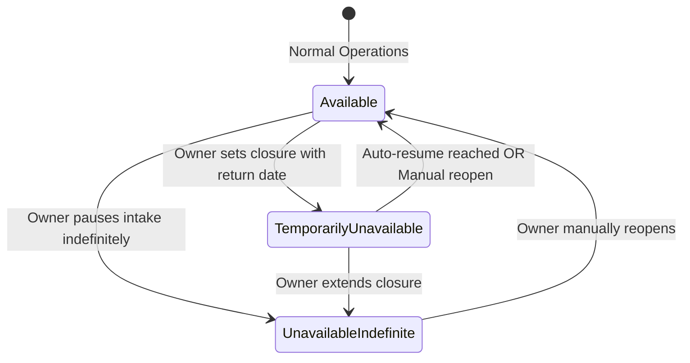
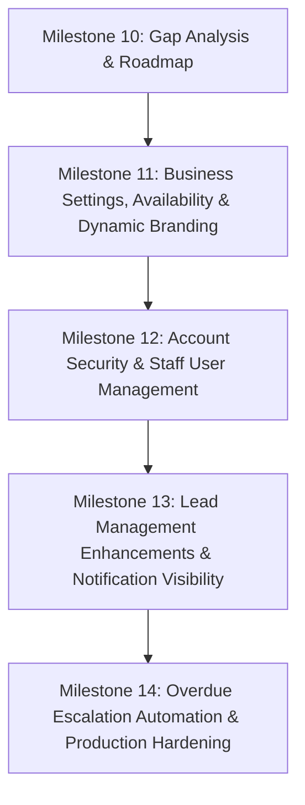

# Milestone 10 — MVP Feature Gap Analysis & Implementation Roadmap

## 1. Executive Summary & Purpose

This document provides a comprehensive technical and operational audit of the **Roofing Lead Management & Automation System** following the successful staging completion of Milestones 1 through 9.

The application currently provides a robust, single-tenant foundation: a responsive public marketing site, a deterministic decision-tree chatbot, transactional quote intake into PostgreSQL 16, a transactional outbox worker, an authenticated owner dashboard with live analytics and lead lifecycle tracking, an n8n webhook workflow with native Header Auth and concurrency locking, and an automated Docker Compose provisioning pipeline.

However, to transition this system from a **functional local staging prototype** into a **reusable, client-ready commercial product** that can be handed over to roofing business owners with minimal developer intervention, critical operational and administrative gaps must be resolved.

### Core Architectural Boundaries & Constraints
- **Single-Client-Per-Deployment**: Each roofing company operates in its own isolated container stack and dedicated PostgreSQL database. No multi-tenant data structures or cross-company aggregation dashboards are permitted.
- **PostgreSQL as Canonical Source of Truth**: All operational business settings, user identities, leads, notes, and outbox logs reside persistently in PostgreSQL.
- **Strict Separation of Concerns**: Public visitors access read-only marketing data and rate-limited quote intake. Authenticated dashboard users access private lead management and administrative settings protected by session cookies and double-submit CSRF tokens.
- **Fail-Safe Lead Ingestion**: Under no circumstance should business unavailability, automation failures, or third-party outages cause incoming lead inquiries to be silently discarded.

---

## 2. Verified Current-State Inventory (Audit of 9 Core Areas)

A comprehensive audit of the active codebase, database schema, API routes, frontend components, and tests was conducted. The findings are categorized into **Implemented**, **Partially Implemented**, **Missing**, and **Test Coverage Status**.

| Area | Current Implementation Status | What Works Today (Verified Facts) | Gaps & Missing Capabilities | Test Coverage Status |
| :--- | :--- | :--- | :--- | :--- |
| **1. Dashboard Overview** | **Partially Implemented** | Live metrics calculated directly from PostgreSQL (`totalLeads`, `last30Days`, `conversionRate`, `urgentAttentionCount` for new leads uncontacted > 24h, status distribution pipeline breakdown). Zero-state guidance for empty databases. | The "Needs Follow-Up" metric card is static text; clicking it does not deep-link or filter the leads list to show those urgent leads. No date range filter (fixed to all-time / 30d). | Verified by unit & integration tests (`dashboard.test.ts`, `DashboardOverviewPage.test.tsx`). |
| **2. Lead Management** | **Implemented** | Full 5-stage lifecycle (`new`, `contacted`, `estimate_scheduled`, `won`, `lost`). Server-side pagination, search, status filtering, and sorting. Lead details view with customer info, project description, and immutable follow-up notes. | Staff cannot edit customer contact typos (phone/email/address). Cannot record scheduled inspection dates/times on the lead entity. No deal revenue/estimate value field. Status update history is not tracked as an audit trail (only `last_status_update` timestamp). | Fully covered by unit, integration, and E2E tests (`leads.management.test.ts`, `LeadDetailPage.test.tsx`, `LeadsListPage.test.tsx`). |
| **3. Business Settings** | **Partially Implemented (Database Seeded Only)** | `business_settings` PostgreSQL table exists. `GET /api/v1/business/public-info` endpoint serves company name, phone, emergency phone, dispatch email, address, service areas, and business hours. | **No Settings UI in dashboard.** No authenticated `GET /api/v1/business/settings` or `PATCH /api/v1/business/settings` endpoints. The public frontend does not fetch from `/api/v1/business/public-info`—it relies on static build-time `VITE_*` environment variables. Modifying company info requires editing `.env`, rebuilding Docker images, and re-seeding the database. | Backend endpoint tested (`api.test.ts`). Settings editing completely untested because endpoints and UI do not exist. |
| **4. Business Availability & Public Notices** | **Missing** | None. The system currently assumes 24/7/365 active intake. | No state model (`available`, `temporarily_unavailable`, `unavailable_indefinite`). No dashboard controls to post public notices, pause quote intake, or schedule reopenings. No backend rejection of quotes when paused. | Completely absent from codebase and tests. |
| **5. Staff / User Management & RBAC** | **Partially Implemented (Single-User Seeded)** | `users` table supports `owner`, `admin`, and `staff` roles. Initial owner seeded during deployment. Session auth and role authorization middleware (`requireRole(['owner', 'admin'])`) exist and function. | **No User Management UI.** No API endpoints to list, invite, create, disable, or manage staff members (`/api/v1/users`). No self-service password change or reset. Adding an estimator requires direct PostgreSQL database manipulation by a developer. | Auth and RBAC middleware tested (`auth.test.ts`, `dashboard.auth.test.tsx`). User administration completely untested. |
| **6. Follow-ups & Overdue Reminders** | **Partially Implemented** | Staff can manually log timestamped notes on leads. Dashboard computes `urgentAttentionCount` (> 24h uncontacted). | No automated notification or email reminder when a lead sits in `new` status > 24 hours (n8n Workflow B is not implemented). No reminder scheduling or follow-up due date fields. | Note creation tested. Reminder delivery non-existent. |
| **7. Notifications & Outbox Resilience** | **Implemented (Backend) / Missing UI** | Transactional outbox pattern with atomic claiming (`FOR UPDATE SKIP LOCKED`), 5 retries with exponential backoff, n8n idempotency logging (`n8n_processed_events`), and Native Header Auth. `leads.automation_status` tracks delivery. | **No UI visibility.** Neither `LeadsListPage` nor `LeadDetailPage` displays `automationStatus` or failure errors. No dashboard screen lists failed outbox events or provides a "Retry Notification" button. Staff cannot tell if a lead notification failed. | Outbox worker and n8n webhook tested (`outbox.worker.test.ts`, `n8n.workflow.test.ts`). UI visibility absent. |
| **8. Security & Hardening** | **Implemented** | Server-managed sessions in PostgreSQL (`connect-pg-simple`), `HttpOnly`/`SameSite=Lax` cookies, double-submit CSRF protection (`X-CSRF-Token`), timing-safe login, rate limiting, and parameterization. | No password change endpoint for authenticated users. No audit log for sensitive administrative actions (status changes, settings updates, user logins). | Fully covered by 39 auth & security test assertions (`auth.test.ts`). |
| **9. Client Onboarding & Operations** | **Implemented (Technical) / Inflexible (Client)** | Automated deployment via Docker Compose, Caddy auto-TLS, automated n8n provisioning script (`provision-n8n.sh`), and verified backup/restore scripts in operations guide. | High developer dependency for onboarding: changing branding requires recompiling frontend Vite bundle via `docker compose build`. No automated cron backup service running in Docker. | Verified in Milestone 8 and 9 staging runs. |

---

## 3. Dedicated Deep-Dive: Business Availability & Public Notices

### 3.1. Business Problem & Operational Need
Roofing businesses frequently experience operational interruptions that require informing prospective customers and adjusting intake behavior without taking the entire website offline:
1. **Severe Weather / Storm Surges**: A major hailstorm or hurricane can generate 200+ quote requests in 48 hours, overwhelming a small roofing team. The owner needs to temporarily pause quote intake while directing active leaks to emergency phone dispatch.
2. **Holiday / Seasonal Closures**: During Thanksgiving, Christmas, or winter shutdowns, the business is closed. Homeowners submitting quotes expect same-day callbacks; when uncontacted, they leave negative reviews. A prominent notice sets accurate response expectations.
3. **Crew Capacity / Material Backlog**: When crews are booked 8 weeks out or shingle supplies are delayed, the owner needs to post an advisory banner explaining lead times before homeowners submit requests.

**Critical Principle**: Business availability is distinct from technical maintenance. The public website must remain 100% accessible so homeowners can verify licensing, read services, and locate emergency contact numbers.

---

### 3.2. Three-State Operational Model



1. **`available` (Normal Operations)**:
   - Full public site navigation.
   - Quote intake form fully active and accepting submissions.
   - Standard chatbot conversation flows.
   - No public availability notice banner.
2. **`temporarily_unavailable` (Scheduled Temporary Closure)**:
   - Public site remains online with a prominent notice banner or announcement card.
   - Displays scheduled return date and time (e.g., *"Our office will reopen Monday, Nov 3 at 7:00 AM"*).
   - Behavior governed by the independent policy flag `acceptQuotesWhenUnavailable`.
   - Supports optional `autoResume`: if `true`, the system automatically transitions back to `available` once the reopening timestamp has passed.
3. **`unavailable_indefinite` (Unscheduled / Indefinite Pause)**:
   - Public site remains online with a custom advisory notice.
   - No return date promised (e.g., *"Quote intake is temporarily paused due to extreme storm response volume"*).
   - Requires explicit manual reopening by an authenticated owner in the dashboard.

---

### 3.3. Policy Enforcement & Website Behavior

#### A. Independent Quote Acceptance Policy (`acceptQuotesWhenUnavailable`)
The owner independently controls whether quote requests are accepted while the business is unavailable:
- **Case 1: Notice Only (`acceptQuotesWhenUnavailable = true`)**:
  - The notice is displayed on the website (e.g., *"We are closed for the holiday weekend"*), but the quote form **remains active**.
  - A prominent disclaimer appears above the form: *"Submissions received during this period will be contacted beginning Monday morning."*
  - Quotes are accepted, saved to PostgreSQL, and dispatched normally.
- **Case 2: Intake Paused (`acceptQuotesWhenUnavailable = false`)**:
  - The quote form on `/contact` and `/` is **replaced** with a clean, branded "Intake Paused" advisory panel explaining the closure and displaying phone/emergency contact options.
  - **Backend Enforcement**: Disabling the form in the UI is NOT sufficient. The backend endpoint `POST /api/v1/leads` must query the active availability status. If intake is paused, the backend **rejects** submissions with `HTTP 422 Unprocessable Entity` or `HTTP 403 Forbidden` returning error code `QUOTE_INTAKE_PAUSED` and an explanatory message.
  - Honeypots and bots attempting direct POST requests cannot bypass the closure.

#### B. Impact on Public Website Components
- **Emergency Contact Banner & Hotline**: Emergency storm leak dispatch (`emergencyPhone`) is an essential safety service and **must remain visible and operational** even when standard quote intake is paused. Active leaks must never be blocked.
- **Chatbot Interaction**:
  - If intake is paused, chatbot flows that route to *"Request a Quote"* dynamically advise the homeowner of the closure and provide direct `tel:` links to the office or emergency line instead of opening a non-functional form.
- **Dashboard Access & Lead Processing**:
  - Owner authentication, staff dashboard access, existing lead records, status updates, notes, and background outbox processing are **never disabled or restricted** by availability state changes.
  - Leads received prior to the pause continue their normal workflow.

---

### 3.4. Persistence Architecture & Schema Design

To avoid introducing external scheduling engines, Redis, or background timer daemons, availability is persisted directly in PostgreSQL within the existing `business_settings` table and evaluated via **deterministic server-side checks**.

#### Database Schema Extension (`business_settings` table):
```sql
ALTER TABLE business_settings
  ADD COLUMN availability_status VARCHAR(30) NOT NULL DEFAULT 'available',
  ADD COLUMN notice_headline VARCHAR(150),
  ADD COLUMN notice_body TEXT,
  ADD COLUMN reopen_at TIMESTAMP WITH TIME ZONE,
  ADD COLUMN auto_resume BOOLEAN NOT NULL DEFAULT false,
  ADD COLUMN accept_quotes_when_unavailable BOOLEAN NOT NULL DEFAULT false;
```

#### Deterministic Reopening Logic (No Fragile Cron Timers):
Instead of relying on an operating system cron job or browser window to trigger state transitions:
1. When any request hits `GET /api/v1/business/public-info` or `POST /api/v1/leads`:
   - If `availability_status === 'temporarily_unavailable'` AND `auto_resume === true` AND `reopen_at <= NOW()`:
     - The backend atomically executes an `UPDATE business_settings SET availability_status = 'available', auto_resume = false WHERE id = ...`.
     - Returns status as `available`.
2. This "lazy evaluation with database commit" pattern is 100% reliable, timezone-safe (stored in UTC), and requires zero background daemons.

---

### 3.5. Owner Dashboard Controls & User Experience

The Business Settings screen in the owner dashboard must include an **Availability & Public Notices** management card:
1. **Current Status Indicator**: Clear visual badge (Green: Active, Amber: Scheduled Temporary Closure, Red: Intake Paused Indefinitely).
2. **Operational State Selector**: Radio group with clear explanations for each of the 3 states.
3. **Public Notice Editor**:
   - Headline input (e.g., *"Holiday Office Closure"*, max 100 chars).
   - Detailed message textarea (e.g., *"Our crews are spending Thanksgiving with family..."*, max 500 chars).
4. **Scheduled Reopening Date & Time**:
   - Datetime picker with explicit business timezone indicator.
   - Checkbox: *"Automatically resume normal operations and quote intake at this time"* (`autoResume`).
5. **Intake Policy Toggle**:
   - Toggle: *"Allow homeowners to submit quote requests while unavailable (with delayed response notice)"* (`acceptQuotesWhenUnavailable`).
6. **Live Preview Panel**:
   - Real-time preview showing exactly how the public announcement banner and quote page will appear to homeowners before saving.
7. **Action Confirmation**:
   - Warning modal when setting `acceptQuotesWhenUnavailable = false`, clearly stating: *"New quote submissions will be rejected until the site reopens."*

---

## 4. Comprehensive Feature Backlog & Prioritization Matrix

Every evaluated feature is cataloged with its business rationale, current status, value, implementation complexity, security considerations, and launch tier.

| Feature Name | Business Problem Solved | Current Status | Client Value | Complexity | Dependencies & Security | Priority |
| :--- | :--- | :--- | :--- | :--- | :--- | :--- |
| **1. Business Settings GUI & Dynamic Branding API** | Owners cannot edit company contact info, address, service areas, or hours without developer editing `.env` and rebuilding containers. | Partially Implemented (Table & GET endpoint exist; no GUI, no PATCH endpoint, frontend uses static env). | **Critical (P0)** | Medium | Backend RBAC (`requireRole(['owner', 'admin'])`), CSRF protection, input validation. | **P0** |
| **2. Business Availability & Public Notice Controls** | Owners cannot announce holiday closures, storm backlogs, or pause quote intake without code deployments. | Missing (No schema, no endpoints, no UI). | **Critical (P0)** | Medium | Schema migration on `business_settings`, backend rejection logic on `POST /leads`, public notice banner component. | **P0** |
| **3. Authenticated Change Password & Profile** | Seeded owner credentials cannot be changed in-app. Handing over an account with `.env` credentials is an operational security risk. | Missing (No endpoint, no UI). | **Critical (P0)** | Low | Verification of current password, bcrypt 12-round re-hashing, CSRF verification. | **P0** |
| **4. Notification Delivery Health & Failed Outbox UI** | If n8n or SMTP fails, staff have no indication that homeowner receipts or internal dispatch emails failed to send. | Implemented in DB/Worker; Missing in UI. | **High (P0)** | Low | Expose `automationStatus` and `lastError` on lead details; add retry action button invoking outbox worker. | **P0** |
| **5. Minimal Staff Account Management** | Roofing owners cannot create estimator logins or deactivate former employees without developer running SQL scripts. | Partially Implemented (`users.role` supports staff; no endpoints, no UI). | **High (P1)** | Medium | Owner-only authorization (`requireRole(['owner'])`), secure password generation, session revocation on deactivate. | **P1** |
| **6. Actionable Dashboard Overdue Drill-Down** | Staff see "Needs Follow-Up: 4" on dashboard but cannot click it to view those specific 4 leads. | Partially Implemented (Metric calculated; no filter in list). | **Medium (P1)** | Low | Add `overdue=true` query param to `GET /api/v1/leads` and clickable link on dashboard card. | **P1** |
| **7. Customer Detail Editing & Scheduled Inspection Date** | Staff cannot fix typos in customer contact fields or record the actual booked inspection calendar date on the lead. | Missing (Leads are immutable except for status and notes). | **High (P1)** | Medium | Add `PATCH /api/v1/leads/:id` with strict validation; add `estimate_date` timestamp column to `leads`. | **P1** |
| **8. Automated 24h Overdue Lead Reminder Workflow** | Leads sitting in `new` for > 24 hours receive no automated escalation to the owner (n8n Workflow B). | Missing (Only Workflow A exists in automation directory). | **Medium (P1)** | Medium | Requires scheduled n8n polling workflow or backend scheduled outbox trigger for `lead.overdue`. | **P1** |
| **9. Structured Status Change History & Audit Log** | Status changes only overwrite `status` and `last_status_update`. Cannot view history of who changed what and when. | Missing (Only notes record author and timestamp). | **Medium (P2)** | Medium | New `lead_activity_log` or `audit_events` table; append-only event stream. | **P2** |
| **10. Automated Off-Host S3 Database Backup** | Backups require manual docker commands. If VPS disk fails, data is lost without off-host copy. | Documented in runbook; no automated container daemon. | **High (P2)** | Medium | Dedicated backup container running cron pg_dump + encrypted upload to AWS S3 / Cloudflare R2. | **P2** |
| **11. Self-Service Forgot Password via Email** | Users locked out must contact the owner or developer to reset passwords in database. | Missing. | **Low (P2)** | Medium | Requires crypto token generation, expiration table, rate limiting, and dedicated SMTP template in n8n. | **P2** |
| **12. Lead CSV Data Export** | Owners cannot export lead lists for accounting, direct mail marketing, or CRM import. | Missing. | **Medium (P2)** | Low | Authenticated `GET /api/v1/leads/export` streaming CSV format. | **P2** |

---

### 4.1. Explicit Evaluation of Deferred & Out-of-Scope Features

To maintain product discipline and prevent scope creep, the following features are **explicitly classified as Out of Scope** for the initial roofing system product:

1. **Multi-Tenant SaaS Administration Dashboard**:
   - *Verdict*: **Out of Scope**.
   - *Rationale*: Contradicts the approved architectural tenet: single-client VPS isolation. Each roofing company receives a dedicated, self-contained deployment.
2. **Complex Calendar Scheduling & Bi-directional Google/Outlook Sync**:
   - *Verdict*: **Out of Scope**.
   - *Rationale*: Full bi-directional calendar integration requires OAuth apps, token refresh daemons, and conflict resolution. A simple `estimateScheduledDate` timestamp field on the lead is sufficient for MVP roofing workflows.
3. **In-App Quoting, Material Takeoffs & Invoicing**:
   - *Verdict*: **Out of Scope**.
   - *Rationale*: Roofing contractors already use specialized estimating tools (e.g., Xactimate, Roofr, JobNimbus, QuickBooks). Building an incomplete quoting engine creates maintenance burden without matching industry tools.
4. **Photo & Document Upload Pipelines**:
   - *Verdict*: **Deferred to Post-Launch**.
   - *Rationale*: Managing homeowner photo uploads requires multi-part S3 storage, virus scanning, image compression, and file size quotas. Text-only quote intake with in-person inspection scheduling satisfies 95% of initial quote workflows.

---

## 5. Recommended Implementation Roadmap & Milestone Sequence

We propose a sequence of small, verifiable milestones. Each milestone delivers an end-to-end, testable business workflow without leaving half-finished pages.



---

### Milestone 11 — Business Settings, Availability Controls & Dynamic Public Information *(COMPLETED)*

- **Status**: **Completed & Verified**.
- **Objective**: Empower the roofing business owner to manage company information, operating hours, service areas, and availability/notice states through a secure dashboard GUI, with full backend policy enforcement and dynamic public website synchronization.
- **Scope & Implemented Features**:
  - **Database Migration**: Created `0004_business_availability.sql` extending `business_settings` with `availability_status`, `notice_headline`, `notice_body`, `reopen_at`, `auto_resume`, `accept_quotes_when_unavailable`, and `timezone`.
  - **Shared Types**: Added `BusinessSettings`, `UpdateBusinessSettingsDto`, `AvailabilityStatus`, `PublicAvailabilityInfo` to `@roofing/shared-types`.
  - **Backend API**:
    - Authenticated `GET /api/v1/business/settings` (Owner/Admin only).
    - Authenticated `PATCH /api/v1/business/settings` (Owner/Admin only, CSRF-protected, Zod-validated).
    - Public `GET /api/v1/business/public-info` returning dynamic branding and availability notices while stripping private dispatch emails and database IDs.
    - Updated `POST /api/v1/leads` enforcing quote intake policy and rejecting with `422 QUOTE_INTAKE_PAUSED` without creating lead or outbox records.
    - Concurrency-safe lazy auto-reopening when `auto_resume = true` and `reopen_at <= now()`.
  - **Frontend UI & Components**:
    - `BusinessInfoProvider` & `useBusinessInfo` context for dynamic public information with fallback branding.
    - `AvailabilityNoticeBanner` component rendering dynamic closure alerts and timezone-aware reopening times.
    - `QuoteForm` rendering paused intake card with direct call links when intake is paused, and delayed notice banner when accepting with notice.
    - Dashboard settings screen [`BusinessSettingsPage.tsx`](file:///Users/aljonfernando/Documents/roofing-lead-management-&-automation-system/frontend/src/pages/BusinessSettingsPage.tsx) at `/dashboard/settings` with **General Information**, **Service Areas & Hours**, and **Availability & Public Notices** tabs, live preview, and pause confirmation modal.
    - Settings navigation item in `DashboardLayout.tsx` for owner/admin roles.
  - **Tests**: 18 new backend assertions in `business.settings.test.ts`, new frontend test suites in `BusinessSettingsPage.test.tsx`, `AvailabilityNoticeBanner.test.tsx`, and `QuoteForm.availability.test.tsx`. All 276 tests passing cleanly across the monorepo.
  - **Backend API**:
    - Add authenticated `GET /api/v1/business/settings` (Owner/Admin only).
    - Add authenticated `PATCH /api/v1/business/settings` (Owner/Admin only, CSRF-protected, validated with Zod).
    - Update `GET /api/v1/business/public-info` to include public availability notice and quote acceptance status.
    - Update `POST /api/v1/leads` to reject submissions with `HTTP 422 QUOTE_INTAKE_PAUSED` if intake is paused.
    - Implement server-side lazy auto-reopening check.
  - **Frontend Public Pages**:
    - Create dynamic `useBusinessInfo` hook / context to fetch public business info from backend API, falling back gracefully to `branding.ts` defaults.
    - Add global `AvailabilityNoticeBanner` to public header/layout.
    - Update `QuoteForm` to render clear "Intake Paused" advisory card when quote intake is paused.
  - **Frontend Dashboard**:
    - Add `Settings` navigation item to `DashboardLayout.tsx`.
    - Create `BusinessSettingsPage.tsx` with tabs: **General Information**, **Service Areas & Hours**, and **Availability & Public Notices**.
    - Include live preview card, confirmation modal, and save confirmation toasts.
- **Tests & Acceptance Criteria**:
  - Unit tests for Zod validation schemas and availability transitions.
  - API integration tests verifying owner update authorization, staff rejection, CSRF enforcement, and public lead rejection when intake is paused.
  - Frontend component tests for notice banners, paused quote forms, and settings forms.

---

### Milestone 12 — Account Security & Staff User Management

- **Objective**: Allow the owner to manage their account security (change password) and provision/deactivate staff estimator accounts within their private single-client deployment.
- **Scope & System Areas Likely to Change**:
  - **Backend API**:
    - Add `POST /api/v1/auth/change-password` (Requires current password, validates length/complexity, updates bcrypt hash, invalidates other sessions).
    - Add `GET /api/v1/users` (Owner only; lists team members).
    - Add `POST /api/v1/users` (Owner only; creates staff/admin account with initial password).
    - Add `PATCH /api/v1/users/:id` (Owner only; update full name, role, or toggle `isActive`).
  - **Frontend Dashboard**:
    - Add `User Profile / Security` modal or tab in settings allowing owner/staff to change password.
    - Add `Team Members` screen (`UsersManagementPage.tsx`) accessible only to users with role `owner`.
    - Form to invite/create staff estimators; toggle to disable access.
- **Tests & Acceptance Criteria**:
  - API tests verifying password change rejects invalid old passwords.
  - Role-based authorization tests: staff cannot view or modify users.
  - Inactive users are immediately rejected at login.

---

### Milestone 13 — Lead Management Enhancements & Notification Visibility

- **Objective**: Improve day-to-day estimator workflows by displaying automation delivery status, enabling customer contact typo fixes, scheduling inspection dates, and providing clickable dashboard overdue filters.
- **Scope & System Areas Likely to Change**:
  - **Database Migration**: Add `estimate_scheduled_date` (timestamp) and `estimated_value` (numeric) to `leads` table.
  - **Backend API**:
    - Add `PATCH /api/v1/leads/:id` to update customer contact info, property location, service type, and estimated value.
    - Update `GET /api/v1/leads` to support `overdue=true` query filter.
    - Add `POST /api/v1/leads/:id/retry-automation` to reset failed outbox events for immediate redelivery.
  - **Frontend Dashboard**:
    - Update `DashboardOverviewPage`: clicking "Needs Follow-Up" navigates to `/dashboard/leads?status=new&overdue=true`.
    - Update `LeadDetailPage`: display `automationStatus` badge (`Delivered`, `Pending`, `Failed` with error message and "Retry" button).
    - Add modal/form on lead detail to edit customer contact information.
    - Add calendar datetime picker when selecting `estimate_scheduled` status.
- **Tests & Acceptance Criteria**:
  - Overdue query correctly filters leads in `new` status > 24 hours.
  - Automation retry resets outbox event `status = 'pending'` and `retryCount = 0`.
  - Customer contact edit tests and validation.

---

### Milestone 14 — Automated Overdue Reminders & Production Hardening

- **Objective**: Implement automated escalation for uncontacted leads (n8n Workflow B), automate database backup routines, and execute pre-production security hardening.
- **Scope & System Areas Likely to Change**:
  - **Automation (n8n)**:
    - Create `roofing-overdue-lead-reminder-workflow.json` running on a scheduled cron trigger (e.g., hourly).
    - Queries PostgreSQL for leads where `status = 'new'` AND `submission_date < NOW() - INTERVAL '24 HOURS'` AND no reminder sent yet.
    - Sends high-priority reminder email/SMS to owner.
  - **Operations & Backups**:
    - Add dedicated lightweight backup service in `docker-compose.yml` to run daily `pg_dump` and retain 14 days of local archives.
  - **Production Audit**:
    - Verify rate limits, CORS origins, and final penetration test checklist.

---

## 6. Risks, Dependencies & Key Decisions Requiring Approval

Before beginning implementation, the following architectural decisions and dependencies must be reviewed:

### Decision 1: Database-Backed Dynamic Branding vs Build-Time Env Variables
- **Context**: The frontend currently reads company name, phone, hours, and service areas from `import.meta.env.VITE_*` (baked into static JavaScript bundle during container build).
- **Proposal**: Have the frontend fetch public business info and availability from `/api/v1/business/public-info` on initial app load, caching in memory and falling back to `branding.ts` defaults.
- **Benefit**: Changing company phone or holiday notices takes effect **instantly** without rebuilding frontend Docker images.
- **Trade-off**: Requires one lightweight public API request when the homepage loads (cached by browser and Caddy reverse proxy).

### Decision 2: Scheduled Reopening Architecture
- **Context**: The owner can set a return time and choose `autoResume`.
- **Proposal**: Use deterministic server-side lazy evaluation during API requests (`reopen_at <= NOW()`), rather than introducing an external scheduling daemon (like Redis or node-cron).
- **Benefit**: Zero new dependencies, zero memory overhead, 100% reliable.

### Decision 3: Quote Rejection Policy Enforcement
- **Context**: When quote intake is paused, does the backend reject requests with an error code or silently accept them into a backlog?
- **Proposal**: Strict rejection (`HTTP 422 QUOTE_INTAKE_PAUSED`) when `acceptQuotesWhenUnavailable = false`. The UI clearly communicates the closure, preventing customer frustration and unmet response expectations.

---

## 7. Recommended Next Implementation Milestone

### **Milestone 11 — Business Settings, Availability Controls & Dynamic Public Information — COMPLETED**

All acceptance criteria for Milestone 11 have been successfully implemented, verified, and tested across backend, frontend, and database tiers.

#### Recommended Next Step:

### **Milestone 12 — Account Security & Staff User Management**

- **Objective**: Implement secure staff account management, self-service password changes, password reset flows, and audit logs.
- **Estimated Effort**: 3–4 days.
- **Prerequisites**: Milestone 11 complete (satisfied).
