# Phased Implementation Plan

## 1. Overview & Phased Roadmap

This implementation plan translates the business requirements from [Overview.md](file:///Users/aljonfernando/Documents/roofing-lead-management-&-automation-system/Overview.md) and working rules from [AGENTS.md](file:///Users/aljonfernando/Documents/roofing-lead-management-&-automation-system/AGENTS.md) into concrete, verifiable implementation milestones. 

In accordance with project rules:
- Work proceeds in **small, verifiable stages**.
- No application source code or unapproved dependencies are introduced without prior milestone authorization.
- Every completed milestone requires testing and user approval before beginning the next milestone.

```mermaid
gantt
    title Roofing System Implementation Timeline
    dateFormat  X
    axisFormat %s

    section Milestone 1
    Initialization & Specifications (Done) :done, m1, 0, 1

    section Milestone 2
    Backend & Database Core                :active, m2, 1, 2

    section Milestone 3
    Public Website & Decision Chatbot      :m3, 2, 3

    section Milestone 4
    Auth & Lead Management Dashboard       :m4, 3, 4

    section Milestone 5
    n8n Automation Pipelines               :m5, 4, 5

    section Milestone 6
    End-to-End Testing & Hardening         :m6, 5, 6

    section Milestone 7
    Docker Compose & VPS Deployment        :m7, 6, 7
```

---

## 2. Milestone Breakdown

### Milestone 1: Project Initialization & Technical Architecture Documentation (Current)
- [x] Initialize Git version control and establish comprehensive [.gitignore](file:///Users/aljonfernando/Documents/roofing-lead-management-&-automation-system/.gitignore).
- [x] Create [.env.example](file:///Users/aljonfernando/Documents/roofing-lead-management-&-automation-system/.env.example) documenting all runtime variables with safe placeholders.
- [x] Produce complete technical specifications in [docs/](file:///Users/aljonfernando/Documents/roofing-lead-management-&-automation-system/docs):
  - [ARCHITECTURE.md](file:///Users/aljonfernando/Documents/roofing-lead-management-&-automation-system/docs/ARCHITECTURE.md)
  - [REQUIREMENTS.md](file:///Users/aljonfernando/Documents/roofing-lead-management-&-automation-system/docs/REQUIREMENTS.md)
  - [DATABASE_SCHEMA.md](file:///Users/aljonfernando/Documents/roofing-lead-management-&-automation-system/docs/DATABASE_SCHEMA.md)
  - [API_SPECIFICATION.md](file:///Users/aljonfernando/Documents/roofing-lead-management-&-automation-system/docs/API_SPECIFICATION.md)
  - [SECURITY.md](file:///Users/aljonfernando/Documents/roofing-lead-management-&-automation-system/docs/SECURITY.md)
  - [DEPLOYMENT.md](file:///Users/aljonfernando/Documents/roofing-lead-management-&-automation-system/docs/DEPLOYMENT.md)
  - [IMPLEMENTATION_PLAN.md](file:///Users/aljonfernando/Documents/roofing-lead-management-&-automation-system/docs/IMPLEMENTATION_PLAN.md)
- [x] Submit report for user review and milestone sign-off.

---

### Milestone 2: Backend Architecture & Database Engine (Phase 4)
**Scope**: Set up the Node.js/Express backend, Drizzle ORM models, migration pipeline, seed script, and health endpoints.

**Deliverables**:
- Monorepo root `package.json` with npm workspaces (`backend`, `frontend`, `packages/shared-types`).
- `backend/` directory initialization with TypeScript, Express, Helmet, CORS, and Morgan.
- Drizzle ORM configuration and database migration scripts for tables: `users`, `sessions`, `business_settings`, `leads`, `lead_notes`, `automation_events`.
- Database seeder (`npm run db:seed`) to create the initial `owner` user and default `business_settings` row without public registration.
- Zod request validation middleware and centralized error handler.
- Core public quote intake route (`POST /api/v1/leads`) storing records persistently.

**Acceptance Criteria**:
- `npm run db:migrate` successfully creates all tables, foreign keys, and indexes on a test PostgreSQL instance.
- `POST /api/v1/leads` validates input using Zod and commits new leads to the database.
- Automated API integration tests verify database persistence, honeypot rejection, and validation error responses.

---

### Milestone 3: Public Website & Decision-Tree Chatbot (Phases 2 & 3)
**Scope**: Build the marketing website and interactive chatbot using React, TypeScript, Vite, and Tailwind CSS.

**Deliverables**:
- `frontend/` project scaffolding (Vite + React + Tailwind CSS + React Router).
- Responsive marketing pages: Home, Services, About Us, Service Areas, Contact / Request a Quote, Privacy Policy.
- Polished UI components: Header/Nav, Footer, Trust Badges, Testimonial Slider, Service Cards, Emergency Contact Banner.
- Quote Request form with live validation and submission handling connecting to `POST /api/v1/leads`.
- Persistent floating decision-tree chatbot with the 5 predefined business questions and quote CTA.
- Configurable static branding tokens (`src/config/branding.ts`) for easy client white-labeling.

**Acceptance Criteria**:
- All 6 pages render cleanly and responsively across mobile, tablet, and desktop viewports.
- Chatbot navigates decision trees without runtime errors and guides the visitor to quote submission or emergency calling.
- Submitting the quote form displays success feedback and records the lead in PostgreSQL.

---

### Milestone 4: Authentication, Lead Management & Dashboard (Phase 5)
**Scope**: Implement secure staff authentication and the internal business dashboard.

**Deliverables**:
- Express session authentication with `connect-pg-simple` and cookie security.
- Auth endpoints: `POST /api/v1/auth/login`, `POST /api/v1/auth/logout`, `GET /api/v1/auth/me`.
- Password verification using Argon2id or bcrypt.
- Dashboard pages:
  - Login view with rate-limit protection.
  - Dashboard Overview with live PostgreSQL-computed statistics.
  - Leads List table with status filters, date sorting, and name/phone search.
  - Lead Details view with status update controls and chronological follow-up notes history.
  - Business Settings view for Owner/Admin users.
- Server-side role enforcement (Staff cannot edit Business Settings).

**Acceptance Criteria**:
- Unauthenticated requests to dashboard routes or protected API endpoints return 401/403.
- Staff can update lead statuses and post follow-up notes that persist and display immediately.
- Dashboard statistics accurately reflect real database counts.

---

### Milestone 5: n8n Automation Workflows (Phase 6)
**Scope**: Build and test the asynchronous automation flows and backend webhook client.

**Deliverables**:
- Outbound webhook client in the backend with timeout handling, retry counter, and `automation_events` logging.
- n8n workflow definition files exported to `automation/workflows/`:
  - `workflow_a_new_lead_notification.json`: Dispatches staff alert email upon new lead.
  - `workflow_b_customer_acknowledgement.json`: Dispatches customer confirmation email.
  - `workflow_c_follow_up_reminder.json`: Scheduled cron identifying stale leads.
- Documentation for importing and activating workflows on self-hosted n8n instances.

**Acceptance Criteria**:
- Creating a lead triggers the webhook to n8n with valid `X-Webhook-Secret`.
- If n8n is offline or returns an error, the lead record remains intact in PostgreSQL with `automation_status = 'failed'` and an error logged in `automation_events`.

---

### Milestone 6: Quality Assurance, Security Hardening & End-to-End Testing (Phase 7)
**Scope**: Full end-to-end verification, automated test suites, and security audit.

**Deliverables**:
- Integration test suite covering authentication, authorization, lead lifecycle, and rate limiting.
- Security audit against OWASP Top 10 vulnerabilities (XSS, CSRF, IDOR, brute force).
- Form failure testing (malformed inputs, network timeouts, duplicate submissions).
- Responsive design and accessibility verification.

**Acceptance Criteria**:
- All automated unit and integration tests pass without failures.
- Rate limiting reliably triggers under load testing on auth and lead intake routes.

---

### Milestone 7: Docker Compose VPS Deployment & Packaging (Phases 8 & 9)
**Scope**: Production containerization, reverse proxy configuration, and deployment automation.

**Deliverables**:
- Multi-stage `Dockerfile` for backend API and frontend static assets.
- Production `docker-compose.yml` orchestrating `proxy`, `frontend`, `backend`, `db`, and `n8n`.
- Caddy reverse proxy configuration with automatic TLS.
- Database backup and recovery shell scripts.
- Client white-label deployment guide detailing step-by-step rollout for new roofing businesses.

**Acceptance Criteria**:
- `docker compose up -d` boots all containers cleanly with passing healthchecks.
- Automated backup script produces valid gzipped PostgreSQL dumps that restore successfully.
